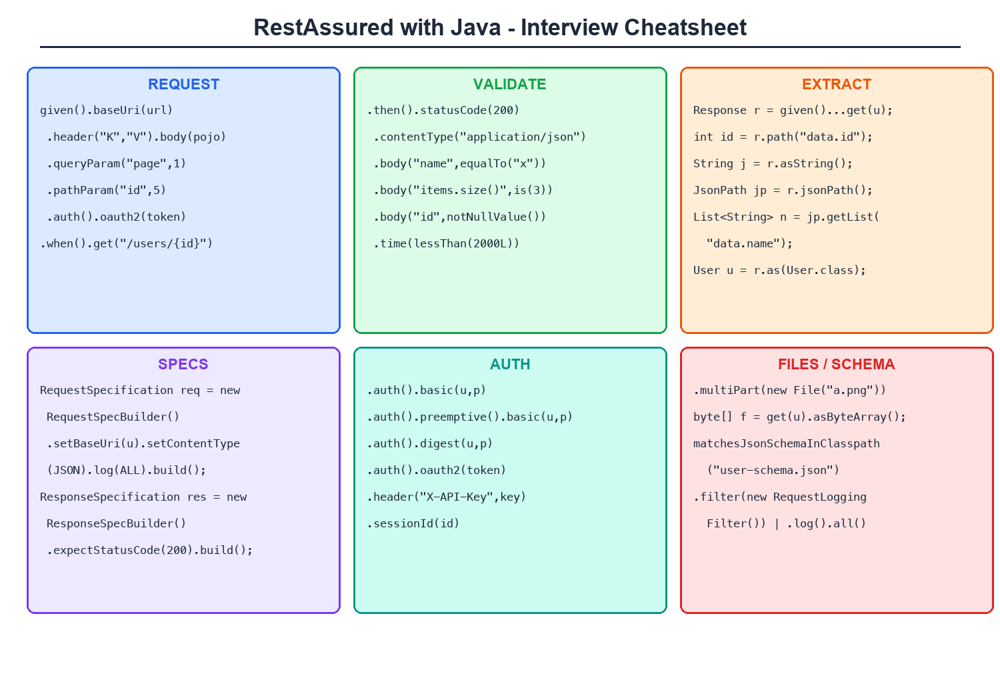
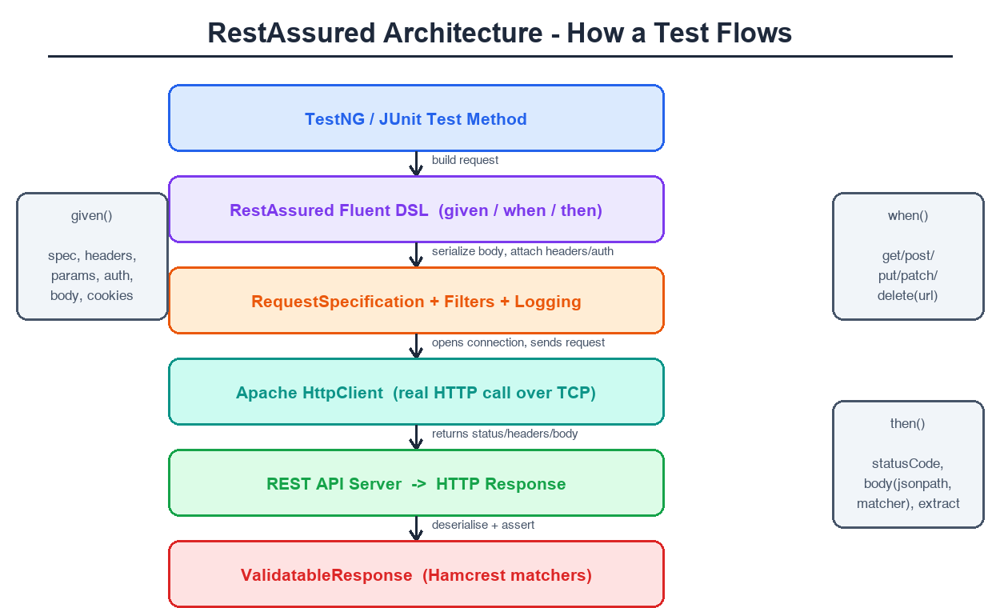
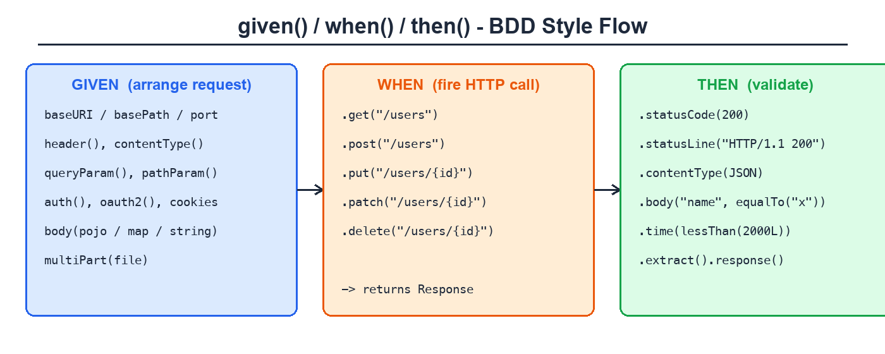
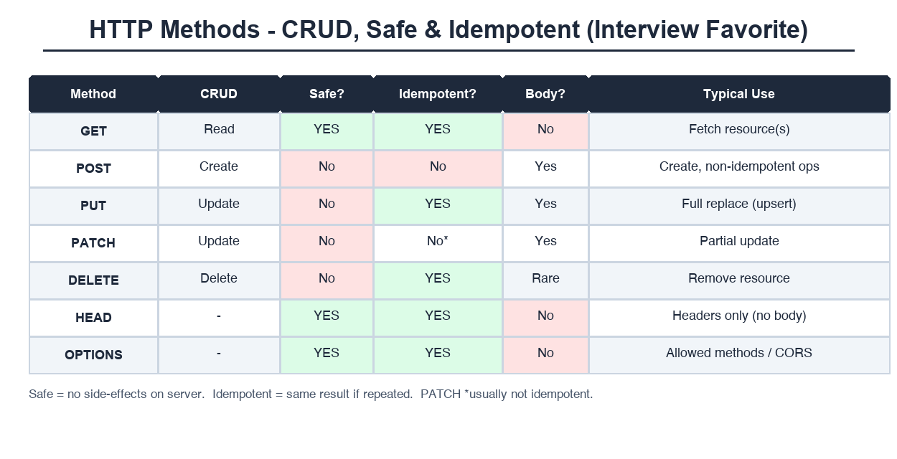
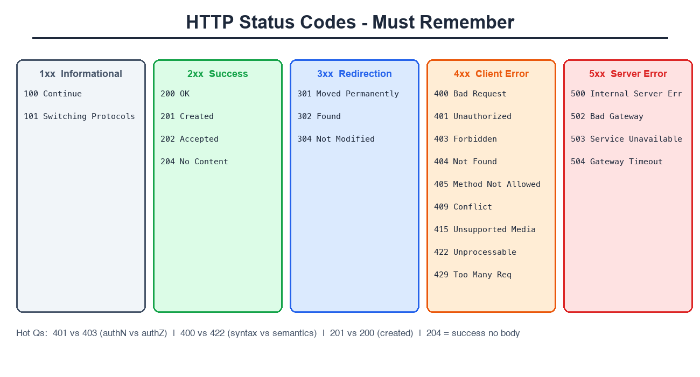
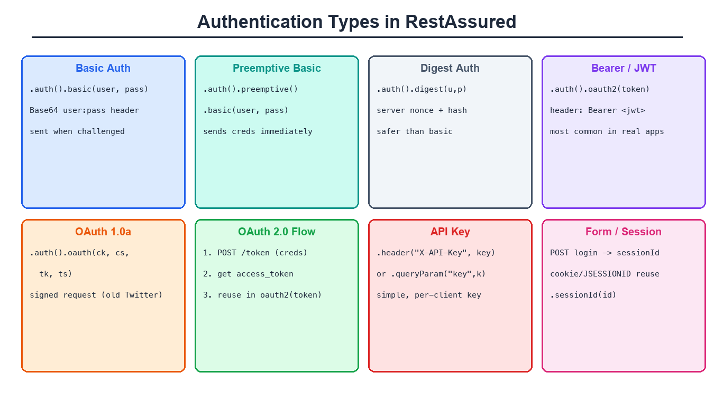
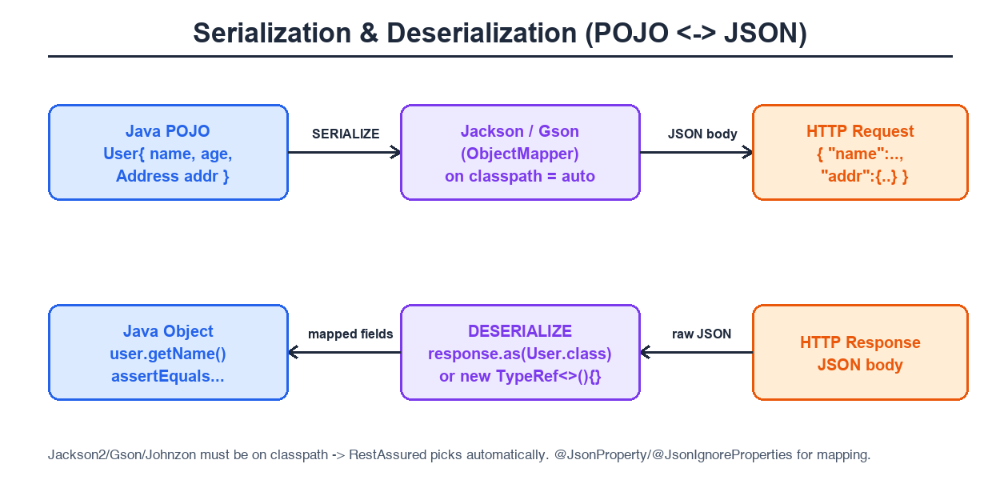
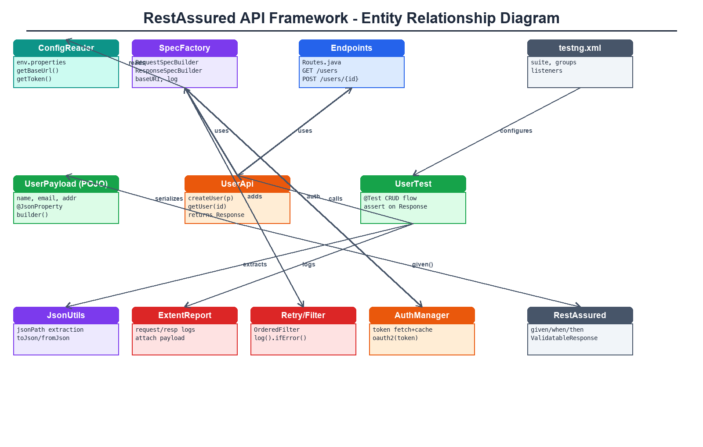

# RestAssured with Java - Complete Interview Preparation Guide

> **Last Updated:** October 2026 | **RestAssured Version:** 5.x (5.5+) | **Java:** 8/11/17/21 | **Build:** Maven/TestNG
>
> **Purpose:** One document for everything — API fundamentals to advanced to deep dive. HTTP → REST → RestAssured DSL → Serialization → Specs → Auth → Schema → Framework → CI/CD, with cheatsheets, diagrams, ER diagrams and interview questions in every section.

---

## 📊 VISUAL QUICK REFERENCE

### 🖼️ RestAssured Cheatsheet (One-Page Revision)


### 🏗️ RestAssured Architecture


### 🔄 given / when / then Flow


### 🌐 HTTP Methods — CRUD, Safe, Idempotent


### 🔢 HTTP Status Codes Map


### 🔐 Authentication Types


### 🔁 Serialization ↔ Deserialization


### 🧬 Framework ER Diagram


---

## 🧠 QUICK RECALL - MEMORY TRICKS

### 🎯 "RESTASSURED" Mnemonic (Remember All Features)
```
R - RequestSpecification (reuse baseURI, headers, auth)
E - Extract (extract().path(), .asString(), .as(POJO.class))
S - Serialization (POJO ↔ JSON via Jackson/Gson)
T - Then (assertions: statusCode, body, time, headers)
A - Authentication (basic, digest, oauth2, apiKey, bearer)
S - Schema validation (matchesJsonSchemaInClasspath)
S - Specs & Filters (RequestSpecBuilder, logging filters)
U - URL handling (baseURI, basePath, pathParam, queryParam)
R - Response validation (Hamcrest matchers, GPath/JsonPath)
E - Expect API (expect().statusCode(200) shortcuts)
D - Deserialization (TypeRef for generics, .as(List.class))
```

### 🔑 One-Liner Golden Rules
| Rule | Remember As |
|------|-------------|
| **given-when-then** | "Arrange → Act → Assert" |
| **given()** | "Sab kuch request ke liye: spec, headers, body, auth" |
| **when()** | "Sirf HTTP method + endpoint" |
| **then()** | "Sirf validation: status, body, time" |
| **pathParam for resource** | `/users/{id}` — WHICH resource |
| **queryParam for filtering** | `?page=2` — HOW to filter/sort |
| **GET/PUT/DELETE idempotent** | "Repeat = same result" |
| **POST not idempotent** | "Repeat = duplicate records" |
| **extract()** | "Validation ke baad data nikalo" |
| **body() path uses GPath** | "Groovy's JSON path, not Jayway" |
| **.log().all()** | "Debug ka best friend — before when() and after then()" |

### ⚡ Quick Patterns (Copy-Paste Ready)

```java
// ============ SIMPLE GET ============
given()
    .baseUri("https://api.example.com")
.when()
    .get("/users/1")
.then()
    .statusCode(200);

// ============ FULL CRUD ONE-LINER STYLE ============
// POST
int id = given()
    .contentType(ContentType.JSON)
    .body(new User("John", "john@test.com"))
.when()
    .post("/users")
.then()
    .statusCode(201)
    .extract().path("id");

// GET + validate body
given().pathParam("id", id)
.when().get("/users/{id}")
.then().statusCode(200)
    .body("name", equalTo("John"))
    .body("email", containsString("@test.com"));

// PUT (full update)
given().contentType(JSON).body(updatedUser)
.when().put("/users/" + id)
.then().statusCode(200);

// DELETE
given().when().delete("/users/" + id)
.then().statusCode(204);

// ============ QUERY + PATH PARAMS ============
given()
    .pathParam("userId", 5)
    .queryParam("page", 2)
    .queryParam("limit", 10)
.when()
    .get("/users/{userId}/posts");

// ============ HEADERS + AUTH ============
given()
    .header("X-API-Key", "key123")
    .auth().oauth2(token)              // Bearer token
.when().get("/secure");

// ============ EXTRACT FULL RESPONSE ============
Response res = given().when().get("/users");
String body   = res.asString();
int status    = res.getStatusCode();
String name   = res.path("data[0].name");
List<String> names = res.jsonPath().getList("data.name");
User user     = res.as(User.class);
List<User> all = res.as(new TypeRef<List<User>>() {});

// ============ REUSABLE SPEC ============
RequestSpecification req = new RequestSpecBuilder()
    .setBaseUri("https://api.example.com")
    .setContentType(ContentType.JSON)
    .addHeader("Accept", "application/json")
    .log(LogDetail.ALL)
    .build();

ResponseSpecification res200 = new ResponseSpecBuilder()
    .expectStatusCode(200)
    .expectContentType(ContentType.JSON)
    .build();

given().spec(req).when().get("/users").then().spec(res200);

// ============ SCHEMA VALIDATION ============
.then().body(matchesJsonSchemaInClasspath("schemas/user.json"));

// ============ LOGGING ============
given().log().all()         // request log
.when().get("/users")
.then().log().all();        // response log
.then().log().ifError();    // only on failure ★
```

### 🎪 RestAssured vs Other API Tools - Quick Recall
| Tool | Style | Best For |
|------|-------|----------|
| **RestAssured** | Java DSL, code-first | Java teams, deep control, CI |
| **Postman** | GUI + collections | Manual exploration, sharing |
| **Karate** | BDD-ish DSL, no Java needed | Non-dev QA, fast writing |
| **Playwright API** | APIRequestContext | Mixed UI+API in same suite |
| **HttpClient** | Raw Java client | Full control, verbose |
| **JMeter** | Load/perf focused | Performance testing |

### 🔢 Numbers to Remember
| Number | What |
|--------|------|
| **200** | OK — success |
| **201** | Created — POST success |
| **204** | No Content — DELETE success |
| **301/302** | Redirects |
| **400** | Bad Request — malformed |
| **401** | Unauthorized — no/bad auth |
| **403** | Forbidden — authenticated but no permission |
| **404** | Not Found |
| **405** | Method Not Allowed |
| **409** | Conflict — e.g. duplicate |
| **415** | Unsupported Media Type — wrong Content-Type |
| **422** | Unprocessable — valid JSON, invalid semantics |
| **429** | Rate limited |
| **500/502/503/504** | Server errors |
| **6** | REST architectural constraints |
| **4** | RestAssured core modules (rest-assured, json-path, xml-path, json-schema-validator) |

### 🏷️ Method Name Tricks
```
given().*      -> request setup: header(), param(), body(), auth(),
                  spec(), cookie(), multiPart(), filter(), log()

when()/get()   -> HTTP verbs: get post put patch delete head options

then().*       -> validation: statusCode() statusLine() body()
                  header() cookie() time() contentType()

extract().*    -> pull data: path() response() asString()
                  as(Class) jsonPath() xmlPath() headers()

log().*        -> log().all() params() headers() body()
                  ifError() ifValidationFails() status()

expect().*     -> inline assertions without then(): expect().statusCode(200)

RestAssured.*  -> globals: baseURI basePath port
                  filters() enableLoggingOfRequestAndResponseIfValidationFails()
```

### 🎭 Interview Quick Answers

**"What is RestAssured?"**
> Java library (DSL) to test REST APIs — given/when/then BDD style, built on Apache HttpClient; parses JSON/XML via Groovy GPath; integrates with TestNG/JUnit.

**"Difference between pathParam and queryParam?"**
> pathParam identifies a resource (`/users/5`), queryParam filters/paginates (`?page=2&sort=name`).

**"PUT vs PATCH?"**
> PUT = full replacement (idempotent), PATCH = partial update (typically not idempotent).

**"401 vs 403?"**
> 401 = not authenticated (missing/bad credentials). 403 = authenticated but not authorized for the resource.

**"How do you validate JSON schema?"**
> `matchesJsonSchemaInClasspath("schema.json")` — needs `json-schema-validator` module.

**"How to serialize POJO to JSON?"**
> Add Jackson/Gson to classpath → `body(pojo)` auto-serializes. Deserialize: `response.as(User.class)`.

**"How to extract value from response?"**
> `then().extract().path("data.id")` or `response.jsonPath().getString("data.id")`.

**"Is RestAssured thread-safe for parallel?"**
> Caution — `RestAssured.baseURI` is static global state. Use per-test `RequestSpecification` objects instead for parallel safety.

### 📝 Checklist Before Interview
```
□ Explain given/when/then and what belongs in each
□ Write a POST + assert + extract id without notes
□ pathParam vs queryParam — examples
□ PUT vs PATCH, idempotent & safe methods table
□ Status codes: 200/201/204/400/401/403/404/422/500
□ POJO serialization: Jackson on classpath + body(obj)
□ Deserialize list: as(new TypeRef<List<User>>(){})
□ RequestSpecBuilder/ResponseSpecBuilder usage
□ All auth types: basic, preemptive, digest, oauth2, api key
□ JSONPath/GPath: filters [?(@.x==1)], findAll, collect
□ Schema validation: matchesJsonSchemaInClasspath
□ Logging: log().all(), ifValidationFails(), filters
□ multiPart upload + byte[] download
□ Framework structure: Routes → Specs → API layer → Tests
□ RestAssured static state + parallel testing caveat
□ WireMock mocking basics
□ REST constraints (6) + Richardson maturity model
```

### 🎨 Visual Memory Aid

```
┌──────────────────────────────────────────────────────────┐
│               RESTASSURED MIND MAP                        │
├──────────────────────────────────────────────────────────┤
│                                                          │
│   given()                    when()          then()      │
│   ─────                      ─────           ─────       │
│   .baseUri()                 .get()          .statusCode │
│   .basePath()                .post()         .body()     │
│   .header()                  .put()          .header()   │
│   .queryParam()              .patch()        .time()     │
│   .pathParam()               .delete()       .extract()  │
│   .formParam()                               .spec()     │
│   .body(pojo/map/str)                                    │
│   .auth() .oauth2()                                      │
│   .multiPart()                                           │
│   .spec(reqSpec) .filter() .log().all()                  │
│                                                          │
│   Response ──> .path() .asString() .as(Class)            │
│                .jsonPath() .headers() .cookies()         │
│                                                          │
│   Modules: rest-assured | json-path | xml-path |         │
│            json-schema-validator | spring-mock-mvc |     │
│            kotlin-extensions                             │
└──────────────────────────────────────────────────────────┘
```

### 🚀 Speed Tricks
| Trick | Saves |
|-------|-------|
| `.log().ifValidationFails()` | Debug only failed tests |
| RequestSpecBuilder reuse | No repeated baseURI/headers |
| `bodyRootPath` | Shorter assertions on nested JSON |
| `.extract().response()` once | Reuse Response object |
| `urlEncodingEnabled(false)` | Pre-encoded URLs untouched |
| `defaultParser` config | Text responses parsed as JSON |
| `relaxedHTTPSValidation()` | Skip SSL issues in test env |
| Global filters for logging | Consistent req/res logging |

---

## TABLE OF CONTENTS

### Core Concepts
1. [API Testing Fundamentals](#1-api-testing-fundamentals)
2. [REST API Concepts](#2-rest-api-concepts)
3. [HTTP Deep Dive](#3-http-deep-dive)
4. [JSON & XML](#4-json--xml)

### RestAssured Basics
5. [RestAssured Fundamentals](#5-restassured-fundamentals)
6. [Setup & Configuration](#6-setup--configuration)
7. [GET Requests](#7-get-requests)
8. [POST Requests](#8-post-requests)
9. [PUT & PATCH Requests](#9-put--patch-requests)
10. [DELETE Requests](#10-delete-requests)
11. [Headers, Parameters & Cookies](#11-headers-parameters--cookies)
12. [Authentication](#12-authentication-in-restassured)
13. [Response Validation](#13-response-validation)
14. [JSONPath Deep Dive (GPath)](#14-jsonpath-deep-dive-gpath)
15. [XmlPath](#15-xmlpath)

### Advanced
16. [Serialization & Deserialization](#16-serialization--deserialization)
17. [Extracting Data from Response](#17-extracting-data-from-response)
18. [RequestSpec & ResponseSpec](#18-requestspec--responsespec-deep-dive)
19. [Logging & Filters](#19-logging--filters)
20. [File Upload & Download](#20-file-upload--download)
21. [Schema Validation](#21-schema-validation)
22. [Assertions with TestNG & AssertJ](#22-assertions-with-testng--assertj)
23. [API Framework Design](#23-api-framework-design)
24. [Parallel Execution & Thread Safety](#24-parallel-execution--thread-safety)
25. [Mocking & Contract Testing](#25-mocking--contract-testing)
26. [GraphQL & SOAP with RestAssured](#26-graphql--soap-with-restassured)
27. [BDD/Cucumber with RestAssured](#27-bddcucumber-with-restassured)
28. [RestAssured vs Other Tools](#28-restassured-vs-other-tools)
29. [CI/CD Integration](#29-cicd-integration)
30. [Latest Features & Version Notes](#30-latest-features--version-notes)
31. [Common Errors & Troubleshooting](#31-common-errors--troubleshooting)
32. [Java for API Testing](#32-java-for-api-testing)
33. [Common Interview Questions](#33-common-interview-questions)

---

## 1. API TESTING FUNDAMENTALS

### What is API Testing?
Testing the application's business-logic layer directly via HTTP requests — no UI. Validates request/response contract: status codes, headers, body structure, data correctness, error handling, performance.

### Why API Testing?
- **Faster** — no browser, milliseconds vs seconds per check
- **Earlier** — test before UI exists (shift-left)
- **More stable** — APIs change less than UI
- **Deeper coverage** — edge cases easy to hit (invalid input, boundary, auth)
- **Cheaper** — less infra, easy parallelization

### API Testing vs UI Testing
| Aspect | API Testing | UI Testing (Selenium) |
|--------|-------------|----------------------|
| Speed | ~ms per call | ~seconds per action |
| Stability | High | Lower (locators break) |
| Coverage | Business logic, data | User flows, rendering |
| Cost | Low infra | Browsers, Grid, flaky infra |
| When | Backend ready | UI ready |
| Catch | Logic/data bugs | UX/visual bugs |

**Interview line:** "UI tests validate the journey; API tests validate the contract. Pyramid = mostly API/unit, few UI."

### Types of API Testing
| Type | What it checks |
|------|----------------|
| Functional | Correct response for valid request |
| Validation | Schema, data types, required fields |
| Negative | Proper errors (400/404/422) for bad input |
| Security | Auth, authZ, injection, rate limits |
| Performance | Response time, load (JMeter) |
| Contract | Provider matches consumer expectation (Pact) |
| Fuzz | Random/malformed input resilience |

### Interview Questions

**Q1: What is API testing?**
- Direct testing of application logic via HTTP — validates status, headers, payload contract without UI.

**Q2: Why prefer API tests over UI?**
- Faster, more stable, earlier in cycle, cheaper, better edge-case coverage. UI tests still needed for critical E2E flows only.

**Q3: What do you validate in an API response?**
- Status code + status line, Content-Type, body fields/values, schema/structure, headers, cookies, response time, error message format for negatives.

**Q4: What is the test pyramid?**
- Unit (many) → API/Integration (some) → UI/E2E (few). Fast cheap tests at bottom, slow brittle at top.

---

## 2. REST API CONCEPTS

### What is REST?
**RE**presentational **S**tate **T**ransfer — architectural style by Roy Fielding. Resources identified by URIs, manipulated via standard HTTP methods, state transferred in representations (JSON/XML).

### REST Principles (6 Constraints) — INTERVIEW FAVORITE
1. **Client-Server** — separation of concerns
2. **Stateless** — each request contains all info needed; no server session
3. **Cacheable** — responses must declare cacheability
4. **Uniform Interface** — resources via URI, standard verbs, self-descriptive messages, HATEOAS
5. **Layered System** — client can't tell proxy/gateway/server apart
6. **Code on Demand** (optional) — server can send executable code (applets/scripts)

### REST Resources
```
Resource:  a "thing" — user, order, product
URI:       /users/42          → unique address
Representation: {"id":42,"name":"John"}   → JSON/XML snapshot
Methods:   GET POST PUT PATCH DELETE      → uniform verbs
```

### Richardson Maturity Model (levels of REST)
```
Level 0 — The Swamp:  POST /doEverything  (one URI, one verb — SOAP-ish)
Level 1 — Resources:  POST /users, POST /orders (many URIs, one verb)
Level 2 — Verbs:      GET/POST/PUT/DELETE on URIs + status codes ★ most APIs here
Level 3 — HATEOAS:    responses contain links to next actions
```

### REST vs SOAP vs GraphQL vs gRPC
| | REST | SOAP | GraphQL | gRPC |
|--|------|------|---------|------|
| Format | JSON/XML/any | XML only | JSON | Protobuf (binary) |
| Contract | Loose (OpenAPI) | Strict (WSDL) | Schema (SDL) | .proto files |
| Verbs | HTTP methods | POST envelope | POST query/mutation | HTTP/2 streams |
| Flexibility | Fixed payloads | Fixed | Client picks fields ★ | Fixed |
| Speed | Fast | Slow (verbose) | Medium | Fastest |
| Use | Most web APIs | Legacy/enterprise (banking) | Complex frontends | Microservice internal |

### HATEOAS (Hypermedia As The Engine Of Application State)
Response contains links — client navigates API via links, not hardcoded URIs:
```json
{
  "id": 42,
  "name": "John",
  "_links": {
    "self":   {"href": "/users/42"},
    "orders": {"href": "/users/42/orders"}
  }
}
```

### Interview Questions

**Q1: What is REST?**
- Architectural style: resources via URIs + uniform HTTP verbs + stateless + representations (JSON).

**Q2: What does stateless mean?**
- Server stores NO client session; every request carries all context (auth token, params). Enables scaling & caching.

**Q3: SOAP vs REST?**
- SOAP = protocol, XML-only, strict WSDL contract, heavier, built-in WS-Security. REST = style, any format, lighter, HTTP-native.

**Q4: What is HATEOAS?**
- Responses include hyperlinks to related actions — client discovers API dynamically (Level 3 of Richardson model).

**Q5: Difference between URI, URL, URN?**
- URI = any identifier. URL = identifier + location (https://host/path). URN = name identifier (urn:isbn:123). All URLs are URIs.

**Q6: What is resource versioning?**
- `/v1/users`, header `Accept: application/vnd.v2+json`, or query `?version=2`. Path versioning most common.

---

## 3. HTTP DEEP DIVE

### HTTP Methods
| Method | CRUD | Safe | Idempotent | Body | Purpose |
|--------|------|------|------------|------|---------|
| GET | Read | ✅ | ✅ | ❌ | Fetch resource(s) |
| POST | Create | ❌ | ❌ | ✅ | Create / trigger action |
| PUT | Update | ❌ | ✅ | ✅ | FULL replace (upsert) |
| PATCH | Update | ❌ | ❌* | ✅ | Partial update |
| DELETE | Delete | ❌ | ✅ | rare | Remove resource |
| HEAD | — | ✅ | ✅ | ❌ | Headers only (no body) |
| OPTIONS | — | ✅ | ✅ | ❌ | Allowed methods / CORS preflight |
| TRACE | — | ✅ | ✅ | ❌ | Echo request (debug, usually disabled) |

**Interview favorites:**
- **Safe** = doesn't modify server state (read-only)
- **Idempotent** = calling N times = same result as once. `PUT /users/5 {same body}` twice → one user state. `POST` twice → two records.
- PATCH *not guaranteed* idempotent (server-defined).

### URL Anatomy
```
https://api.example.com:8443/v1/users/42/orders?status=open&page=2#frag
└─┬─┘  └──────┬──────┘└─┬─┘└┬┘└──────────┬──────────┘└──────┬──────┘└─┬─┘
scheme      host      port path      path params      query params  fragment
                          (never sent to server — browser-only)
```

### HTTP Status Codes — FULL MAP
| Range | Meaning | Key Codes |
|-------|---------|-----------|
| **1xx** | Informational | 100 Continue, 101 Switching Protocols |
| **2xx** | Success | 200 OK, 201 Created, 202 Accepted, 204 No Content, 206 Partial |
| **3xx** | Redirect | 301 Moved Permanently, 302 Found, 304 Not Modified, 307/308 Temp/Perm Redirect |
| **4xx** | Client Error | 400 Bad Request, 401 Unauthorized, 403 Forbidden, 404 Not Found, 405 Method Not Allowed, 406 Not Acceptable, 409 Conflict, 410 Gone, 415 Unsupported Media, 422 Unprocessable, 429 Too Many Requests |
| **5xx** | Server Error | 500 Internal Server Error, 501 Not Implemented, 502 Bad Gateway, 503 Service Unavailable, 504 Gateway Timeout |

**Hot pairs to distinguish:**
- **401 vs 403** → unauthenticated vs unauthorized (authN vs authZ)
- **400 vs 422** → malformed syntax vs valid syntax but invalid semantics
- **404 vs 405** → resource missing vs wrong verb on existing resource
- **301 vs 302** → permanent vs temporary redirect
- **500 vs 503** → code error vs temporarily down/overloaded

### Important HTTP Headers
```
Request:
  Authorization: Bearer <token>        Content-Type: application/json
  Accept: application/json             User-Agent, Cookie
  X-API-Key, If-None-Match (ETag), If-Modified-Since
Response:
  Content-Type, Content-Length, ETag, Cache-Control
  Set-Cookie, Location (on 201/redirect), WWW-Authenticate (on 401)
  Retry-After (on 429/503), X-RateLimit-* , Server
```

### Content Negotiation
- Client sends `Accept: application/json` → server replies matching `Content-Type`
- Mismatch → **406 Not Acceptable**

### Request Lifecycle (what actually happens)
```
Client → DNS resolve → TCP connect → TLS handshake →
HTTP request (method + path + headers + body) →
Server app → DB →
HTTP response (status + headers + body)
```

### Interview Questions

**Q1: PUT vs PATCH?**
- PUT replaces whole resource (send all fields, idempotent). PATCH sends only changed fields (typically non-idempotent).

**Q2: Idempotent methods?**
- GET, PUT, DELETE, HEAD, OPTIONS (safe ones + PUT/DELETE). POST and PATCH are not.

**Q3: When 201 vs 200?**
- 201 = resource created (POST success, should return Location header). 200 = generic success.

**Q4: What does 429 mean and response header?**
- Rate limited → look at `Retry-After`.

**Q5: What's in an HTTP request?**
- Request line (METHOD path HTTP/version), headers, optional body. Response: status line, headers, body.

**Q6: Can GET have a body?**
- Spec doesn't forbid but it's meaningless/ignored by most servers — don't do it.

---

## 4. JSON & XML

### JSON (JavaScript Object Notation)
```json
{
  "id": 42,
  "name": "John",
  "active": true,
  "tags": ["admin", "qa"],
  "address": {
    "city": "NYC",
    "zip": "10001"
  },
  "orders": [
    {"id": 1, "total": 99.5},
    {"id": 2, "total": 45.0}
  ],
  "middleName": null
}
```
- Types: string, number, boolean, null, object `{}`, array `[]`
- Lightweight, no tags, native to browsers — **REST default**

### XML (eXtensible Markup Language)
```xml
<user id="42">
    <name>John</name>
    <active>true</active>
    <address>
        <city>NYC</city>
    </address>
</user>
```
- Verbose, attributes + elements, namespaces, schema (XSD/DTD) validation

### JSON vs XML
| | JSON | XML |
|--|------|-----|
| Readability | Clean | Verbose tags |
| Size | Smaller | Larger |
| Arrays | Native | Simulated via repeated elements |
| Schema | JSON Schema (optional) | XSD/DTD built-in |
| Use | Modern REST | SOAP, legacy, configs |

### Why JSON dominates
- Direct map to JS objects → cheap parsing
- RestAssured's `JsonPath` (Groovy GPath) makes field access trivial: `address.city`, `orders[0].id`

### Interview Questions

**Q1: JSON vs XML?**
- JSON lighter, human-readable, native arrays, standard for REST. XML verbose but has mature schema validation.

**Q2: Valid JSON types?**
- object, array, string, number, boolean, null. No undefined/date — dates are strings (ISO 8601).

**Q3: How do you read nested JSON in RestAssured?**
- Dot/bracket path: `data.address.city`, `orders[0].id`, `data[?(@.active==true)]`.

---

## 5. RESTASSURED FUNDAMENTALS

### What is RestAssured?
- **Java DSL** for testing REST APIs — BDD style `given().when().then()`
- Built on **Apache HttpClient** (real HTTP calls)
- Parses JSON via **Groovy GPath** (json-path module), XML via xml-path
- Assertions via **Hamcrest matchers**
- Modules: `rest-assured`, `json-path`, `xml-path`, `json-schema-validator`, `spring-mock-mvc`, `kotlin-extensions`

### Key Features
- Fluent readable syntax — test reads like English
- Auto serialization/deserialization (Jackson/Gson)
- Reusable `RequestSpecification` / `ResponseSpecification`
- Built-in auth (Basic, Digest, OAuth 1/2, Form)
- JSON schema validation module
- Filters for logging/interception
- Spring MockMvc support (test without server)

### RestAssured Architecture
```
TestNG/JUnit test
   → given() builds RequestSpecification
   → filters applied (logging, auth)
   → Apache HttpClient sends real HTTP request
   → Server responds
   → then() builds ValidatableResponse
   → Hamcrest matchers assert status/body/headers
   → extract() pulls data out
```

### Maven Dependencies
```xml
<!-- core -->
<dependency>
    <groupId>io.rest-assured</groupId>
    <artifactId>rest-assured</artifactId>
    <version>5.5.0</version>
    <scope>test</scope>
</dependency>
<!-- JSON schema validation -->
<dependency>
    <groupId>io.rest-assured</groupId>
    <artifactId>json-schema-validator</artifactId>
    <version>5.5.0</version>
    <scope>test</scope>
</dependency>
<!-- serialization (pick one) -->
<dependency>
    <groupId>com.fasterxml.jackson.core</groupId>
    <artifactId>jackson-databind</artifactId>
    <version>2.18.0</version>
</dependency>
<!-- or Gson -->
<dependency>
    <groupId>com.google.code.gson</groupId>
    <artifactId>gson</artifactId>
    <version>2.11.0</version>
</dependency>
<!-- TestNG -->
<dependency>
    <groupId>org.testng</groupId>
    <artifactId>testng</artifactId>
    <version>7.10.2</version>
    <scope>test</scope>
</dependency>
```

### First Test
```java
import static io.restassured.RestAssured.*;
import static org.hamcrest.Matchers.*;

public class FirstTest {
    @Test
    public void getUser() {
        given()
            .baseUri("https://reqres.in")
        .when()
            .get("/api/users/2")
        .then()
            .statusCode(200)
            .body("data.first_name", equalTo("Janet"));
    }
}
```

### Interview Questions

**Q1: What is RestAssured?**
- Java library/DSL for REST API testing — given-when-then fluent API on Apache HttpClient, GPath response parsing, Hamcrest validation.

**Q2: Which libraries does RestAssured use internally?**
- Apache HttpClient (transport), Groovy (GPath for JSON path eval), Hamcrest (matchers), Jackson/Gson (serialization — must add yourself).

**Q3: Why add Jackson/Gson dependency separately?**
- RestAssured serializes POJOs using whichever mapper is on the classpath — it doesn't bundle one (lets you choose).

**Q4: What is ValidatableResponse?**
- Object returned by `then()` — supports chained assertions (.statusCode, .body, .time) and `.extract()`.

---

## 6. SETUP & CONFIGURATION

### Basic Setup
```java
// Global static config (simple projects)
RestAssured.baseURI = "https://api.example.com";
RestAssured.port = 8443;
RestAssured.basePath = "/v1";
// resulting calls go to https://api.example.com:8443/v1/...
```

```java
// Prefer per-request baseUri in real frameworks (thread-safe)
given().baseUri("https://api.example.com")
       .basePath("/v1");
```

### RestAssuredConfig — global tweaks
```java
import io.restassured.config.*;

RestAssuredConfig config = RestAssured.config()
    // serialization mapper
    .objectMapperConfig(ObjectMapperConfig.objectMapperConfig()
        .defaultObjectMapper(new ObjectMapper()))
    // redirect behavior
    .redirect(RedirectConfig.redirectConfig().followRedirects(false))
    // SSL
    .sslConfig(SSLConfig.sslConfig().relaxedHTTPSValidation())
    // http client
    .httpClient(HttpClientConfig.httpClientConfig()
        .setParam("http.connection.timeout", 5000)
        .setParam("http.socket.timeout", 5000))
    // decode content-type
    .decoderConfig(DecoderConfig.decoderConfig()
        .defaultContentCharset("UTF-8"))
    // encode
    .encoderConfig(EncoderConfig.encoderConfig()
        .defaultContentCharset("UTF-8"));

given().config(config).when().get("/users");
```

### Common configs
```java
// SSL issues in test env
given().relaxedHTTPSValidation();

// Proxy
given().proxy("proxy.corp.com", 8080);

// Don't follow redirects (to assert 302 itself)
given().redirects().follow(false);

// URL already encoded — don't re-encode
given().urlEncodingEnabled(false)
       .get("/search?q=hello%20world");
```

### Interview Questions

**Q1: How to set base URL?**
- `RestAssured.baseURI` (global static) or `given().baseUri()` / RequestSpecBuilder (preferred — no global state).

**Q2: How to handle self-signed SSL certs?**
- `relaxedHTTPSValidation()` on request or via `RestAssuredConfig.sslConfig`.

**Q3: How to set timeouts?**
- `HttpClientConfig` params (`http.connection.timeout`, `http.socket.timeout`) via RestAssuredConfig.

**Q4: How to disable redirect following?**
- `given().redirects().follow(false)` or RedirectConfig.

## 7. GET REQUESTS

### Basic GET Request
```java
given()
    .baseUri("https://reqres.in")
.when()
    .get("/api/users/2")
.then()
    .statusCode(200)
    .log().body();
```

### GET with Path Parameters
```java
// {userId} placeholder — substituted by pathParam
given()
    .pathParam("userId", 5)
.when()
    .get("/api/users/{userId}")
.then()
    .statusCode(200);
// URL becomes /api/users/5

// multiple path params
given()
    .pathParam("userId", 5)
    .pathParam("postId", 12)
.when()
    .get("/users/{userId}/posts/{postId}");
```

### GET with Query Parameters
```java
given()
    .queryParam("page", 2)
    .queryParam("per_page", 10)
.when()
    .get("/api/users");
// URL becomes /api/users?page=2&per_page=10
```

### GET and Validate Response
```java
given()
.when()
    .get("/api/users?page=2")
.then()
    .statusCode(200)
    .contentType(ContentType.JSON)
    .body("page", equalTo(2))
    .body("data", hasSize(6))
    .body("data[0].email", containsString("@reqres.in"))
    .body("data.id", hasItems(7, 8))
    .body("total", greaterThan(10))
    .time(lessThan(2000L));            // response time
```

### GET and Extract Response
```java
Response response =
given()
.when()
    .get("/api/users/2")
.then()
    .statusCode(200)
    .extract().response();             // full Response object

int    id    = response.path("data.id");
String email = response.jsonPath().getString("data.email");
long   time  = response.getTime();
```

### Interview Questions

**Q1: How do you send query params in RestAssured?**
- `.queryParam("k","v")` → appended after `?`. Multiple `.queryParam()` calls chain. `queryParams(map)` for a Map.

**Q2: GET vs POST?**
- GET = read, safe+idempotent, params in URL (logged/cached), no body. POST = create/action, body payload, not cached, not idempotent.

**Q3: How to assert response time?**
- `.time(lessThan(2000L))` or `.extract().time()` / `response.getTime()`.

---

## 8. POST REQUESTS

### Basic POST Request
```java
given()
    .contentType(ContentType.JSON)
    .body("{\"name\":\"John\",\"job\":\"QA\"}")
.when()
    .post("/api/users")
.then()
    .statusCode(201)
    .body("name", equalTo("John"))
    .body("id", notNullValue());
```

### POST with HashMap
```java
Map<String, Object> payload = new HashMap<>();
payload.put("name", "John");
payload.put("job", "QA Lead");
payload.put("skills", List.of("selenium", "api"));

given()
    .contentType(ContentType.JSON)
    .body(payload)                     // auto-serialized to JSON
.when()
    .post("/api/users")
.then()
    .statusCode(201);
```

### POST with POJO ★ (best practice)
```java
// POJO — needs Jackson/Gson on classpath
public class User {
    private String name;
    private String job;
    // constructor, getters, setters (or Lombok @Data)
}

User user = new User("John", "QA");

given()
    .contentType(ContentType.JSON)
    .body(user)                        // serialized automatically
.when()
    .post("/api/users")
.then()
    .statusCode(201);
```

### POST and Validate + Extract Created ID
```java
int id =
given()
    .contentType(ContentType.JSON)
    .body(user)
.when()
    .post("/api/users")
.then()
    .statusCode(201)
    .body("name", equalTo("John"))
    .extract().path("id");             // or .extract().path("id", Integer.class)
```

### POST with Form Data
```java
given()
    .contentType("application/x-www-form-urlencoded")
    .formParam("username", "john")
    .formParam("password", "secret")
.when()
    .post("/login");
```

### POST raw JSON from File
```java
String json = new String(Files.readAllBytes(
        Paths.get("src/test/resources/payloads/user.json")));
given().contentType(JSON).body(json).post("/users");
```

### Interview Questions

**Q1: Ways to send a POST body in RestAssured?**
- Raw JSON string, Map, POJO (auto-serialized), File content, formParam (x-www-form-urlencoded), multiPart (multipart/form-data).

**Q2: Why ContentType.JSON needed?**
- Sets `Content-Type: application/json` so server parses body correctly — missing it can cause 415/400.

**Q3: Expected status after create?**
- 201 Created (with `Location` header ideally). Some APIs return 200 — know your contract.

---

## 9. PUT & PATCH REQUESTS

### PUT Request — FULL update
```java
User updated = new User("John Updated", "Lead QA");   // ALL fields

given()
    .contentType(ContentType.JSON)
    .pathParam("id", 5)
    .body(updated)
.when()
    .put("/api/users/{id}")
.then()
    .statusCode(200)
    .body("job", equalTo("Lead QA"));
```

### PATCH Request — PARTIAL update
```java
Map<String, Object> patch = Map.of("job", "Senior QA"); // only changed field

given()
    .contentType(ContentType.JSON)
    .body(patch)
.when()
    .patch("/api/users/5")
.then()
    .statusCode(200);
```

### PUT vs PATCH — INTERVIEW FAVORITE
| | PUT | PATCH |
|--|-----|-------|
| Payload | Entire resource | Only changed fields |
| Idempotent | ✅ YES | ❌ usually NO |
| Missing fields | Set to null/default | Untouched |
| Use | Full replace/upsert | Partial edit |

**Classic trap:** sending PATCH-style partial body via PUT → server may wipe other fields.

### Interview Questions

**Q1: PUT vs PATCH?**
- See table. PUT idempotent full-replace; PATCH partial.

**Q2: If you PUT a resource that doesn't exist?**
- Depends on API — PUT is allowed to create (upsert semantics) returning 201, or 404 if server only supports update.

**Q3: What status for successful PUT/PATCH?**
- 200 (returns updated resource) or 204 (no body returned).

---

## 10. DELETE REQUESTS

### Basic DELETE
```java
given()
    .pathParam("id", 5)
.when()
    .delete("/api/users/{id}")
.then()
    .statusCode(204);                  // 204 No Content typical
```

### DELETE and Validate + Verify Deletion
```java
// delete → 204, then GET → 404
given().when().delete("/api/users/5").then().statusCode(204);
given().when().get("/api/users/5").then().statusCode(404);
```

### DELETE with Body (rare but legal)
```java
given()
    .contentType(JSON)
    .body(Map.of("reason", "gdpr"))
.when()
    .delete("/api/users/5");
```

### Interview Questions

**Q1: Expected status after DELETE?**
- 204 No Content (most common) or 200 OK if server returns body.

**Q2: Is DELETE idempotent?**
- YES — deleting twice ends in same state (resource gone); second call may 404 but state identical.

**Q3: How do you verify a delete really worked?**
- Follow-up GET → expect 404. Also check it's gone from list endpoint.

---

## 11. HEADERS, PARAMETERS & COOKIES

### Add Headers
```java
given()
    .header("Content-Type", "application/json")
    .header("Accept", "application/json")
    .header("X-Custom-Header", "value")
    .header("Authorization", "Bearer " + token);

// or Headers object / Map
Headers h = new Headers(new Header("A","1"), new Header("B","2"));
given().headers(h);
given().headers(Map.of("K1","V1","K2","V2"));
```

### Parameter Types — THE comparison
```java
// Path param — part of URL path, identifies resource
given().pathParam("id", 5).get("/users/{id}");
//   → /users/5

// Query param — after ?, filter/sort/paginate
given().queryParam("status", "active").get("/users");
//   → /users?status=active

// Form param — body as x-www-form-urlencoded
given().contentType("application/x-www-form-urlencoded")
       .formParam("user", "john").post("/login");

// Generic param — query for GET, form for POST
given().param("key", "v");

// Multi-value
given().queryParam("ids", 1, 2, 3);            // ?ids=1&ids=2&ids=3
given().queryParams(Map.of("a","1","b","2")); // map
```

### Cookies
```java
given().cookie("session", "abc123")
       .cookies("k1","v1","k2","v2")
       .cookie(new Cookie.Builder("token","x").setSecured(true).build());

// read response cookies
String session = response.getCookie("JSESSIONID");
Map<String,String> all = response.getCookies();
```

### Interview Questions

**Q1: pathParam vs queryParam?**
- path = identify resource `/users/5`; query = modify request `/users?sort=name`. PATH IS PART OF RESOURCE IDENTITY.

**Q2: How to send same param multiple times?**
- `queryParam("id", 1, 2, 3)` → `?id=1&id=2&id=3`.

**Q3: How to read/set cookies?**
- `.cookie()` on request; `response.getCookie(name)` / `getCookies()` on response.

**Q4: formParam vs queryParam?**
- formParam goes in BODY (POST, urlencoded). queryParam goes in URL.

---

## 12. AUTHENTICATION IN RESTASSURED

### Basic Authentication
```java
given().auth().basic("user", "pass")          // waits for 401 challenge then resends
       .when().get("/secure");
```

### Preemptive Basic
```java
// sends credentials in FIRST request — no challenge round-trip
given().auth().preemptive().basic("user", "pass")
       .when().get("/secure");
```
★ Interview: "basic waits for 401 challenge; preemptive sends creds upfront."

### OAuth 2.0 / Bearer Token
```java
// Bearer token — most common real-world
given().auth().oauth2(accessToken)              // → Authorization: Bearer <token>
       .when().get("/api/user");

// manual equivalent
given().header("Authorization", "Bearer " + token);
```

```java
// Full OAuth2 flow — fetch token first, then use
String token =
given()
    .contentType("application/x-www-form-urlencoded")
    .formParam("grant_type", "client_credentials")
    .formParam("client_id", CLIENT_ID)
    .formParam("client_secret", CLIENT_SECRET)
.when()
    .post("https://auth.example.com/oauth/token")
.then()
    .statusCode(200)
    .extract().path("access_token");

// reuse
given().auth().oauth2(token).get("/api/users");
```

### OAuth 1.0a
```java
given().auth().oauth(consumerKey, consumerSecret,
                     accessToken, tokenSecret)
       .when().get("/api");
```

### API Key
```java
// header-based
given().header("X-API-Key", "myapikey123");
// or query-based
given().queryParam("api_key", "myapikey123");
```

### Digest Authentication
```java
given().auth().digest("user", "pass").when().get("/digest-auth");
```

### Form Authentication (session-based)
```java
// POST login form → get session cookie → reuse
given().auth().form("user", "pass",
        new FormAuthConfig("/login", "username", "password"))
       .when().get("/profile");

// or manual session
String sessionId = given().formParam("u","x").formParam("p","y")
    .post("/login").getSessionId();
given().sessionId(sessionId).get("/profile");
```

### Interview Questions

**Q1: Authentication types in RestAssured?**
- basic, preemptive basic, digest, oauth1, oauth2(bearer), form-based, API key (header/query), session/cookie.

**Q2: basic() vs preemptive().basic()?**
- basic sends creds only after server challenge (401). preemptive sends immediately — use preemptive when API doesn't issue challenge (most REST APIs).

**Q3: How do you automate OAuth2 token flow?**
- POST token endpoint with grant_type/client creds → extract `access_token` → pass to `oauth2(token)`. Cache + refresh on expiry in real frameworks.

**Q4: How to handle CSRF in form auth?**
- `FormAuthConfig` with `withAutoDetectionOfCsrf()` — auto-finds CSRF field and sends it.

---

## 13. RESPONSE VALIDATION

### Status Code / Line / Content-Type
```java
.then()
    .statusCode(200)
    .statusLine("HTTP/1.1 200 OK")     // exact
    .statusLine(containsString("200")) // partial
    .contentType(ContentType.JSON)
    .contentType("application/json; charset=utf-8");
```

### Validate Body (Hamcrest matchers — MEMORIZE)
```java
import static org.hamcrest.Matchers.*;
import static org.hamcrest.MatcherAssert.assertThat;

.then().body(
    "id", equalTo(5),
    "name", equalTo("John"),
    "email", containsString("@test.com"),
    "age", greaterThan(18),
    "age", lessThanOrEqualTo(60),
    "token", notNullValue(),
    "middleName", nullValue(),
    "tags", hasItems("admin", "qa"),
    "tags", hasSize(3),
    "data.id", hasItems(1, 5, 7),
    "status", anyOf(equalTo("ok"), equalTo("pending")),
    "price", closeTo(99.9, 0.5),
    "name", matchesPattern("[A-Z][a-z]+"),
    "data", everyItem(hasKey("id")),
    "data", not(empty())
);
```

**Hamcrest quick list:** `equalTo, not, containsString, startsWith, endsWith, hasItem, hasItems, hasSize, hasKey, hasValue, hasEntry, empty, emptyArray, notNullValue, nullValue, greaterThan, lessThan, closeTo, anyOf, allOf, everyItem, instanceOf, isA, matchesPattern, equalToIgnoringCase`.

### Validate Nested Fields
```java
.then()
    .body("data.address.city", equalTo("NYC"))
    .body("data.orders[0].id", equalTo(1))
    .body("data.orders.total", hasItems(99.5f, 45f))
    .body("data.orders.findAll{it.total>50}.id", hasItem(1)); // GPath filter!
```

### Validate Headers & Cookies
```java
.then()
    .header("Content-Type", containsString("application/json"))
    .header("X-RateLimit-Remaining", notNullValue())
    .cookie("JSESSIONID", notNullValue());
```

### Validate Response Time
```java
.then().time(lessThan(2000L))                      // ms
.then().time(greaterThan(100L).and(lessThan(3000L)));
.then().time(lessThan(2L), TimeUnit.SECONDS);
```

### bodyRootPath — shortcut for nested roots
```java
.then()
    .rootPath("data.user")                 // all paths relative now
    .body("name", equalTo("John"))         // = data.user.name
    .body("id", equalTo(5));
```

### Interview Questions

**Q1: How to validate multiple fields in one body()?**
- `.body("a", equalTo(1), "b", equalTo(2), "c", notNullValue())` — path/matcher pairs.

**Q2: How to check array size?**
- `body("data", hasSize(6))` or `body("data.size()", is(6))`.

**Q3: How to validate response time?**
- `.time(lessThan(2000L))`; combine with TimeUnit for seconds.

**Q4: What matcher for "any of several values"?**
- `anyOf(equalTo("a"), equalTo("b"))`; `allOf` for AND.

**Q5: What is rootPath?**
- `rootPath("data")` prefixes all subsequent body paths — cleaner for deeply nested JSON.

---

## 14. JSONPATH DEEP DIVE (GPATH)

RestAssured's `JsonPath` uses **Groovy GPath** — dot notation + Groovy expressions. (Note: differs slightly from Jayway JsonPath `$` syntax — interview trap!)

### Basic
```java
JsonPath jp = new JsonPath(jsonString);
// or from response
JsonPath jp = response.jsonPath();

jp.getString("data.name");
jp.getInt("data.id");
jp.getBoolean("data.active");
jp.getDouble("data.price");
jp.getList("data.tags");                     // List<Object>
jp.getList("data.name", String.class);       // typed
jp.getMap("data.address");                   // Map
jp.getObject("data", User.class);            // POJO!
```

### Path syntax
```groovy
data.name                    // field
data.orders[0].id            // array index
data.orders.id               // ALL ids → list  ★ implicit collect
data.orders[-1].id           // last element
data.orders.id[0]            // first id
```

### GPath filters & functions — POWER MOVES
```java
// find first matching
jp.get("data.orders.find { it.total > 50 }.id");      // first match
// find all matching
jp.getList("data.orders.findAll { it.total > 50 }.id");
// collect transform
jp.getList("data.users.collect { it.name.toUpperCase() }");
// aggregates
jp.getDouble("data.orders.total.sum()");
jp.getDouble("data.orders.total.max()");
jp.getDouble("data.orders.total.min()");
jp.get("data.orders.size()");
// condition fields
jp.getList("data.users.findAll { it.age > 18 && it.active }");
// sort
jp.getList("data.orders.sort { it.total }.id");
// 'it' = current element; use explicit param: {u -> u.age > 18}
```

```java
// equivalent bracket filter syntax (Jayway-style inside GPath)
jp.getList("data.orders[?(@.total > 50)].id");
jp.getList("data.users[?(@.name == 'John')].id");
```

### Path arguments (parameterized)
```java
// %s placeholders — reusable paths!
jp.getString("data.orders[%d].id", 0);
JsonPath jp = new JsonPath(res).using(
        JsonPathConfig.jsonPathConfig()
            .rootPath("data.users"));      // everything relative
```

### Interview Questions

**Q1: How to get all ids from a JSON array?**
- `jp.getList("data.id")` — implicit collect, or `getList("data.id", Integer.class)`.

**Q2: How to filter array elements in JsonPath?**
- `findAll { it.x > y }` / `find { ... }` / `[?(@.x == 'v')]` syntax.

**Q3: RestAssured JsonPath vs standard JsonPath?**
- Uses Groovy GPath — no leading `$.`, supports Groovy closures (`findAll`, `collect`, `sum`), plus `[?()]` bracket filters.

**Q4: How to get last element of array?**
- `data.orders[-1].id` or `data.orders[-1]`.

**Q5: How to sum a numeric field across array?**
- `jp.getDouble("orders.total.sum()")`.

---

## 15. XMLPATH

```java
// For XML responses — contentType XML
given().accept(ContentType.XML)
.when().get("/users.xml")
.then()
    .statusCode(200)
    .body("users.user[0].name", equalTo("John"))
    .body("users.user.@id", equalTo("42"))       // attribute via @
    .body("users.user.size()", equalTo(3));

// XmlPath standalone
XmlPath xp = new XmlPath(response.asString());
List<String> names = xp.getList("users.user.name");

// namespaces
xp = new XmlPath(CompatibilityMode.HTML, xml)
        .using(XmlPathConfig.xmlPathConfig()
            .declaredNamespace("x", "http://ns.example.com"));
xp.getString("x:user.x:name");
```

### Interview Questions

**Q1: How to validate XML responses?**
- Same `.body()` assertions with element paths; `@attr` for attributes, `size()` for counts; namespaces via XmlPathConfig.

## 16. SERIALIZATION & DESERIALIZATION

### Serialization = Java → JSON (request body)
### Deserialization = JSON → Java (response)

Auto-handled when a mapper is on classpath:
- **Jackson** (`jackson-databind`) — most common
- **Gson** — Google's
- **Johnzon**, **Jackson1**, **Yasson** — also supported

### POJO Example
```java
public class User {
    private String name;
    private int age;
    private Address address;            // nested POJO
    private List<String> tags;

    // getters + setters REQUIRED for default serialization
    // (or public fields / Lombok @Data)
}

public class Address {
    private String city;
    private String zip;
    // getters/setters
}
```

```java
// Serialize → request
User u = new User("John", 30, new Address("NYC", "10001"));
given().contentType(JSON).body(u).post("/users");

// Deserialize → response
User back = given().get("/users/5").as(User.class);
Assert.assertEquals(back.getName(), "John");

// List of POJOs — TypeRef needed (generics type erasure!)
List<User> users = response.as(new TypeRef<List<User>>() {});
```

### Lombok POJO (clean version)
```java
@Data @Builder @NoArgsConstructor @AllArgsConstructor
public class User {
    private String name;
    private int age;
    private Address address;
}
User u = User.builder().name("John").age(30).build();
```

### Jackson Annotations — KNOW THESE
```java
public class User {
    @JsonProperty("user_name")          // JSON key ≠ field name
    private String name;

    @JsonIgnore                         // never serialize
    private String password;

    @JsonInclude(Include.NON_NULL)      // skip null fields
    private String nickname;

    @JsonIgnoreProperties(ignoreUnknown = true)   // on class: unknown resp fields OK
    ...
}
```

### Choosing mapper / custom ObjectMapper
```java
RestAssuredConfig cfg = RestAssured.config()
    .objectMapperConfig(ObjectMapperConfig.objectMapperConfig()
        .jackson2ObjectMapperFactory((cls, charset) -> {
            ObjectMapper om = new ObjectMapper();
            om.registerModule(new JavaTimeModule());  // LocalDate support
            return om;
        }));
```

### Gson instead of Jackson
```java
// just have gson on classpath — or force via config:
ObjectMapperConfig.objectMapperConfig()
    .gsonObjectMapperFactory((cls, charset) -> new Gson());
```

### Serializer for custom type
```java
ObjectMapperConfig.objectMapperConfig()
    .defaultObjectSerializerFactory((ctx) -> /* your Serializer */);
```

### Interview Questions

**Q1: How to send POJO as JSON body?**
- `body(pojo)` + Jackson or Gson on classpath. RestAssured auto-serializes using field getters.

**Q2: How to map response to List of objects?**
- `response.as(new TypeRef<List<User>>() {})` — TypeRef preserves generics; plain `List.class` loses element type.

**Q3: JSON field name differs from Java field?**
- `@JsonProperty("api_name")` (Jackson) or `@SerializedName` (Gson).

**Q4: Server returns extra unknown fields — deserialization fails?**
- `@JsonIgnoreProperties(ignoreUnknown = true)` on POJO or ObjectMapper config.

**Q5: Serialization exception "no serializer found"?**
- Missing mapper dependency, or no getters/public fields. Add jackson-databind + accessors.

---

## 17. EXTRACTING DATA FROM RESPONSE

### Ways to extract — ALL of them
```java
// 1. .path() on Response — single value
Response r = given().get("/users/5");
String name = r.path("data.name");
int    id   = r.path("data.id");
List<String> tags = r.path("data.tags");

// 2. then().extract() — fluent
String name = given().get("/users/5")
    .then().statusCode(200)
    .extract().path("data.name");

Response res = given().get("/users/5")
    .then().extract().response();          // whole Response

// 3. jsonPath() object — reusable extraction
JsonPath jp = res.jsonPath();
jp.getString("data.name");
jp.getList("data.orders.id");

// 4. Deserialize to POJO
User u = res.as(User.class);

// 5. Raw forms
String raw = res.asString();               // pretty string
byte[] bytes = res.asByteArray();          // binary (files)
InputStream is = res.asInputStream();

// 6. Headers / cookies / status
String ct    = res.getContentType();
Headers hdrs = res.getHeaders();
String c     = res.getCookie("session");
int    sc    = res.getStatusCode();
long   ms    = res.getTime();
```

### extract() family
```java
.extract().response()        // Response object
.extract().path("a.b")       // single path value
.extract().as(User.class)    // POJO
.extract().asString()
.extract().body()            // ResponseBody
.extract().header("X-Y")
.extract().cookie("k")
.extract().headers()
.extract().jsonPath()        // JsonPath object
.extract().time()
```

### Interview Questions

**Q1: extract().path() vs response.path()?**
- Same result; `then().extract().path()` chains assertions first, `response.path()` works on stored Response.

**Q2: How to use extracted value in next request (chaining)?**
```java
int id = given().body(u).post("/users").then().extract().path("id");
given().pathParam("id", id).get("/users/{id}").then().statusCode(200);
```

**Q3: How to assert on extracted data with TestNG?**
```java
User u = res.as(User.class);
Assert.assertEquals(u.getName(), "John");   // TestNG asserts on POJO fields
```

---

## 18. REQUESTSPEC & RESPONSESPEC DEEP DIVE

### Why Specs?
Avoid repeating baseURI/headers/auth/expected-status in EVERY test. Specs = reusable request/response templates.

### RequestSpecification
```java
RequestSpecification reqSpec = new RequestSpecBuilder()
    .setBaseUri("https://api.example.com")
    .setBasePath("/v1")
    .setContentType(ContentType.JSON)
    .addHeader("Accept", "application/json")
    .addHeader("X-API-Key", ConfigReader.get("apiKey"))
    .setAuth(RestAssured.oauth2(token))        // or .auth().oauth2 in spec? use setAuth
    .addQueryParam("locale", "en")
    .log(LogDetail.ALL)                        // auto-log request
    .build();

// per-test override still works
given().spec(reqSpec)
       .pathParam("id", 5)                     // merges with spec
.when().get("/users/{id}");
```

### ResponseSpecification
```java
ResponseSpecification resSpec = new ResponseSpecBuilder()
    .expectStatusCode(200)
    .expectContentType(ContentType.JSON)
    .expectResponseTime(lessThan(2000L))
    .expectBody("data", notNullValue())
    .log(LogDetail.ALL)
    .build();

given().spec(reqSpec)
.when().get("/users")
.then().spec(resSpec);                          // all expectations checked
```

### expect() shortcut (spec-less assertions mid-chain)
```java
given().spec(reqSpec)
.when().get("/users")
.then().spec(resSpec);
// equivalent alternate ordering:
expect().spec(resSpec).when().get("/users");   // less common
```

### Global defaults
```java
RestAssured.requestSpecification  = reqSpec;    // applies to every request
RestAssured.responseSpecification = resSpec;
RestAssured.defaultParser = Parser.JSON;        // parse text/plain as JSON
// reset in @AfterSuite:
RestAssured.reset();
```

### Spec merging
```java
// request spec values are overridden by per-request settings;
// specs merge — duplicate headers combine
given().spec(reqSpec).header("Accept", "text/plain");  // adds, not replaces
```

### Interview Questions

**Q1: RequestSpecBuilder vs ResponseSpecBuilder?**
- ReqSpec = reusable request config (uri, headers, auth, params, logging). ResSpec = reusable expectations (status, contentType, time, body).

**Q2: How to apply spec to ALL tests?**
- `RestAssured.requestSpecification = spec` global — but careful with parallel tests (static state); better: `given().spec(spec)` per call or ThreadLocal spec.

**Q3: Can per-request settings override spec?**
- Yes — last wins for scalar values; headers/cookies/params merge.

---

## 19. LOGGING & FILTERS

### Inline logging
```java
given().log().all()                    // request: method,uri,headers,cookies,body
       .log().uri()                    // just URI
       .log().params()                 // just params
       .log().headers()
       .log().body()
       .log().cookies()
       .log().method()
.when().get("/users")
.then().log().all()                    // response: status,headers,body
       .log().status()
       .log().body()
       .log().ifError()                // only if status>=400 ★
       .log().ifValidationFails();     // only if assertions fail ★
```

### Global fail-logging
```java
RestAssured.enableLoggingOfRequestAndResponseIfValidationFails();
// or on spec: .log(LogDetail.STATUS) selectively
```

### Filters — intercept request/response
```java
import io.restassured.filter.*;
import io.restassured.filter.log.*;
import io.restassured.filter.session.*;

// Built-in filters
given()
    .filter(new RequestLoggingFilter())        // log request
    .filter(new ResponseLoggingFilter())       // log response
    .filter(new ErrorLoggingFilter())          // log only errors
    .filter(new SessionFilter());              // capture session automatically

// Log to file instead of console
try (PrintStream ps = new PrintStream(
        new FileOutputStream("target/req.log", true))) {
    given().filter(new RequestLoggingFilter(ps))
           .filter(new ResponseLoggingFilter(ps));
}
```

### Custom Filter (OrderedFilter)
```java
public class TimingFilter extends OrderedFilter {
    @Override
    public Response filter(FilterableRequestSpecification req,
                           FilterableResponseSpecification res,
                           FilterContext ctx) {
        long start = System.currentTimeMillis();
        Response response = ctx.next(req, res);   // ★ continue chain
        long ms = System.currentTimeMillis() - start;
        System.out.println(req.getMethod() + " " + req.getURI()
                + " took " + ms + "ms");
        return response;
    }
    @Override public int getOrder() { return 1000; }
}
// global:  RestAssured.filters(new TimingFilter());
// or:      RestAssured.replaceFiltersWith(new TimingFilter());
```

### Interview Questions

**Q1: How to log request & response?**
- `.log().all()` before `when()` (request) and after `then()` (response); `.log().ifError()`/`.ifValidationFails()` conditional; filters for global control.

**Q2: What are filters?**
- Interceptors around the HTTP call — logging, session capture, metrics. OrderedFilter lets you control execution order; `ctx.next(req,res)` continues the chain.

**Q3: How to log to a file?**
- `new RequestLoggingFilter(printStream)` — pass a FileOutputStream-backed PrintStream.

---

## 20. FILE UPLOAD & DOWNLOAD

### File Upload — multiPart
```java
// POST multipart/form-data file
given()
    .multiPart(new File("src/test/resources/report.pdf"))
.when()
    .post("/upload")
.then().statusCode(200);

// with control name + mime type + extra fields
given()
    .multiPart("file", new File("avatar.png"), "image/png")
    .multiPart("username", "john")
    .formParam("desc", "profile pic")
.when()
    .post("/profile/avatar");

// upload raw bytes/string
given().multiPart("file", "data.csv",
        "col1,col2\n1,2".getBytes(), "text/csv");
```

### File Download
```java
// as byte array
byte[] file = given().when().get("/files/report.pdf")
    .then().statusCode(200)
    .extract().asByteArray();
Files.write(Paths.get("report.pdf"), file);

// stream (large files)
InputStream in = given().get("/files/big.zip").asInputStream();
```

### Interview Questions

**Q1: How to upload a file?**
- `.multiPart(file)` or `.multiPart(controlName, file, mimeType)` — multipart/form-data.

**Q2: How to download & save a file?**
- `extract().asByteArray()` → Files.write; or `asInputStream()` for large files.

---

## 21. SCHEMA VALIDATION

### JSON Schema Validation
```java
// module: io.rest-assured:json-schema-validator
import static io.restassured.module.jsv.JsonSchemaValidator.*;

.then().body(matchesJsonSchemaInClasspath("schemas/user-schema.json"));
```

```json
// src/test/resources/schemas/user-schema.json
{
  "$schema": "http://json-schema.org/draft-07/schema#",
  "type": "object",
  "required": ["id", "name", "email"],
  "properties": {
    "id":    {"type": "integer"},
    "name":  {"type": "string", "minLength": 1},
    "email": {"type": "string", "format": "email"},
    "tags":  {"type": "array", "items": {"type": "string"}}
  }
}
```

```java
// settings: check draft/version, or validate string directly
JsonSchemaValidator.matchesJsonSchema(jsonSchemaString)
JsonSchemaValidatorSettings.settings()
    .with().checkedValidation(false);   // structure only, not strict draft
```

### XML Schema (XSD)
```java
.then().body(matchesXsdInClasspath("schemas/user.xsd"));
.then().body(matchesXsd(xsdString));
```

### Interview Questions

**Q1: How to validate JSON schema?**
- `matchesJsonSchemaInClasspath("schema.json")` — separate module `json-schema-validator`.

**Q2: Schema validation vs field assertions?**
- Schema checks structure/types/required fields for EVERY element at once; field assertions check specific values. Use schema + a few spot assertions.

**Q3: Where do schema files live?**
- `src/test/resources/schemas/` (classpath).

---

## 22. ASSERTIONS WITH TESTNG & ASSERTJ

### RestAssured built-in (Hamcrest inside body())
```java
.then().body("id", equalTo(5));           // soft-style chained check
```

### TestNG asserts on extracted data — for complex logic
```java
Response res = given().get("/users");
List<User> users = res.as(new TypeRef<List<User>>() {});

Assert.assertEquals(res.getStatusCode(), 200);
Assert.assertTrue(users.size() > 0);
Assert.assertTrue(users.stream().allMatch(u -> u.getEmail().contains("@")));

// SoftAssert — collect failures
SoftAssert soft = new SoftAssert();
soft.assertEquals(res.getStatusCode(), 200);
soft.assertTrue(users.get(0).isActive());
soft.assertAll();
```

### AssertJ (fluent asserts)
```java
import static org.assertj.core.api.Assertions.*;

assertThat(users).hasSize(6);
assertThat(users).extracting(User::getName).contains("John");
assertThat(users).allMatch(u -> u.getAge() > 0);
```

### Interview Questions

**Q1: body() matcher vs TestNG Assert?**
- body() with Hamcrest = declarative on JSON path; TestNG Assert = on extracted Java objects (loops, custom logic). Mix: declarative for contract, Assert for business checks.

**Q2: Hard vs soft assertions in API tests?**
- then() chain naturally validates all listed conditions; SoftAssert for extracted-object checks.

---

## 23. API FRAMEWORK DESIGN

### Real Project Folder Structure
```
src/test/java/com/api/
├── endpoints/          Routes.java — all URIs as constants
├── specs/              SpecFactory.java — Request/Response specs
├── payloads/           User.java, Order.java (POJOs + builders)
├── apis/               UserApi.java — thin wrappers (createUser, getUser)
├── tests/              UserApiTest.java
├── utils/              ConfigReader, JsonUtils, TokenManager, TestDataFactory
├── filters/            LoggingFilter, RetryFilter
└── listeners/          ExtentListener, TestListener
src/test/resources/
├── config/             qa.properties, staging.properties
├── schemas/            user-schema.json
├── payloads/           create-user.json (templates)
└── testng.xml
```

### Routes.java
```java
public class Routes {
    public static final String USERS      = "/users";
    public static final String USER_BY_ID = "/users/{id}";
    public static final String LOGIN      = "/auth/login";
}
```

### SpecFactory.java
```java
public class SpecFactory {
    public static RequestSpecification request() {
        return new RequestSpecBuilder()
            .setBaseUri(ConfigReader.get("base.url"))
            .setContentType(ContentType.JSON)
            .addHeader("Accept", "application/json")
            .log(LogDetail.URI).log(LogDetail.METHOD)
            .build();
    }
    public static RequestSpecification authenticated() {
        return new RequestSpecBuilder()
            .addRequestSpecification(request())
            .setAuth(RestAssured.oauth2(TokenManager.getToken()))
            .build();
    }
    public static ResponseSpecification ok() {
        return new ResponseSpecBuilder()
            .expectStatusCode(200)
            .expectContentType(ContentType.JSON)
            .expectResponseTime(lessThan(3000L))
            .build();
    }
}
```

### UserApi.java — thin API layer
```java
public class UserApi {
    public static Response create(User user) {
        return given().spec(SpecFactory.authenticated())
                .body(user)
                .when().post(Routes.USERS);
    }
    public static Response get(int id) {
        return given().spec(SpecFactory.authenticated())
                .pathParam("id", id)
                .when().get(Routes.USER_BY_ID);
    }
    public static Response delete(int id) {
        return given().spec(SpecFactory.authenticated())
                .pathParam("id", id)
                .when().delete(Routes.USER_BY_ID);
    }
}
```

### UserApiTest.java
```java
public class UserApiTest {
    @Test
    public void createUser_returnsCreatedUser() {
        User user = TestDataFactory.randomUser();
        Response res = UserApi.create(user);
        res.then().statusCode(201)
           .body("name", equalTo(user.getName()));

        User created = res.as(User.class);
        Assert.assertEquals(created.getEmail(), user.getEmail());
    }

    @Test
    public void getUser_contract() {
        UserApi.get(5).then()
            .spec(SpecFactory.ok())
            .body(matchesJsonSchemaInClasspath("schemas/user-schema.json"));
    }
}
```

### Interview Questions

**Q1: Explain your API framework design.**
- Routes (constants) → SpecFactory (reusable request/response specs) → POJO payloads (Lombok builders) → thin API wrapper classes returning `Response` → TestNG tests asserting contract+data → ConfigReader per env → listeners/reports.

**Q2: Why wrap RestAssured calls in API classes?**
- Tests stay business-readable; endpoint changes touch one file; token handling centralized.

**Q3: How to handle token refresh?**
- TokenManager caches token + expiry; `authenticated()` spec calls it; refresh on 401/expiry (interceptor or lazy check).

---

## 24. PARALLEL EXECUTION & THREAD SAFETY

### The Trap
`RestAssured.baseURI`, `requestSpecification`, `filters` are **STATIC GLOBAL** — parallel tests share them → cross-contamination.

### Safe Patterns
```java
// 1. Per-request specs — no static state  ★ BEST
given().spec(SpecFactory.request())...

// 2. ThreadLocal spec (if you must keep instance per thread)
private static ThreadLocal<RequestSpecification> tlSpec =
        ThreadLocal.withInitial(SpecFactory::request);
given().spec(tlSpec.get())...
```

```xml
<!-- testng.xml -->
<suite parallel="methods" thread-count="5">
```

```java
// Parallel-safe DataProvider
@DataProvider(parallel = true)
public Object[][] ids() { ... }
```

### Interview Questions

**Q1: Is RestAssured thread-safe?**
- The DSL is, but `RestAssured.*` static fields are shared — parallel tests overriding baseURI/filters race. Solution: per-call specs, no static mutation during parallel runs.

**Q2: How to run API tests in parallel?**
- TestNG `parallel="methods"` + spec objects per request (no globals) + parallel DataProvider for bulk data.

## 25. MOCKING & CONTRACT TESTING

### WireMock — mock API server
```java
// dependency: org.wiremock:wiremock-standalone
WireMockServer wm = new WireMockServer(8089);

@BeforeClass
public void start() { wm.start(); }
@AfterClass
public void stop()  { wm.stop(); }

@Test
public void mockedGet() {
    wm.stubFor(get("/api/users/1")
        .willReturn(aResponse()
            .withStatus(200)
            .withHeader("Content-Type", "application/json")
            .withBody("{\"id\":1,\"name\":\"Mock\"}")));

    given().baseUri("http://localhost:8089")
    .when().get("/api/users/1")
    .then().statusCode(200)
           .body("name", equalTo("Mock"));
}
```

```java
// fault injection — test your client's resilience!
wm.stubFor(get("/slow").willReturn(aResponse().withFixedDelay(5000)));
wm.stubFor(get("/err").willReturn(aResponse().withStatus(500)
        .withFault(Fault.CONNECTION_RESET_BY_PEER)));

// verify call happened
wm.verify(postRequestedFor(urlEqualTo("/api/users"))
        .withHeader("Content-Type", containing("json")));
```

### Contract Testing (Pact — awareness level)
- Consumer defines expected request/response → provider verifies it can satisfy → catches breaking changes between microservices without integration env.

### Interview Questions

**Q1: How to test against an API that doesn't exist yet?**
- WireMock/MockServer stub from contract (OpenAPI), or Postman mocks; consumer-driven contract tests with Pact.

**Q2: How do you test retry logic for 5xx?**
- Stub faults with WireMock (`withStatus(503)`, `withFault(CONNECTION_RESET)`).

---

## 26. GRAPHQL & SOAP WITH RESTASSURED

### GraphQL = POST with query body
```java
String query = "{ \"query\": \"{ user(id:5){ name email } }\" }";

given()
    .contentType(ContentType.JSON)
    .body(query)                          // or {"query":..., "variables":{...}}
.when()
    .post("/graphql")
.then()
    .statusCode(200)
    .body("data.user.name", equalTo("John"));
// GraphQL always returns 200 — check "errors" array for failures! ★
.then().body("errors", nullValue());
```

### SOAP = POST XML envelope
```java
String soap =
    "<soapenv:Envelope xmlns:soapenv='http://schemas.xmlsoap.org/soap/envelope/'>"
  + "<soapenv:Body><GetUser><id>5</id></GetUser></soapenv:Body></soapenv:Envelope>";

given()
    .contentType("text/xml; charset=utf-8")
    .header("SOAPAction", "GetUser")
    .body(soap)
.when()
    .post("/soap/service")
.then()
    .statusCode(200)
    .body(hasXPath("//name[text()='John']"));   // XML assertion
```

### Interview Questions

**Q1: Can RestAssured test GraphQL?**
- Yes — GraphQL is just HTTP POST with JSON `{"query": ...}`. Assert `data.*` and check `errors` field (GraphQL returns 200 even on errors).

**Q2: Can RestAssured test SOAP?**
- Yes — POST XML envelope with text/xml content type; validate via XPath (`hasXPath`).

---

## 27. BDD/CUCUMBER WITH RESTASSURED

### 🎯 Quick Revision Cheatsheet
```
┌─────────────────────────────────────────────────────────────────────────────┐
│                    BDD/CUCUMBER QUICK REFERENCE                              │
├─────────────────────────────────────────────────────────────────────────────┤
│  📁 FILE TYPES:                                                             │
│     .feature     →  API scenarios in Gherkin                                │
│     ApiSteps.java→  Step definitions (RestAssured calls)                    │
│     Hooks.java   →  @Before/@After (load config, reset specs)               │
│     Runner.java  →  @CucumberOptions + AbstractTestNGCucumberTests          │
│                                                                             │
│  🔑 FLOW:                                                                   │
│     Given base uri is set        → given().spec(reqSpec)                    │
│     When I send GET /users/1     → .when().get("/users/1")                  │
│     Then status code should be 200 → .then().statusCode(200)                │
│                                                                             │
│  💾 SHARING STATE:                                                          │
│     PicoContainer → shared TestContext (Response, token, id)                │
│     across all step classes — injected via constructor                      │
│                                                                             │
│  🏷️ TAGS:  @smoke @regression @negative @contract @crud                     │
│  🔧 OPTIONS: features / glue / plugin / tags / dryRun / monochrome          │
└─────────────────────────────────────────────────────────────────────────────┘
```

### What is BDD / Cucumber / Gherkin?
> **BDD:** Tests written in plain English that business + dev + QA all understand — `Given` (precondition), `When` (action), `Then` (assertion).
> **Cucumber:** Parses `.feature` Gherkin files and runs the matching Java step definitions.
> **Gherkin:** The keyword language — `Feature`, `Scenario`, `Given`, `When`, `Then`, `And`, `But`, `Background`, `Scenario Outline`, `Examples`.

### Why Cucumber with RestAssured?
```
┌─────────────────────────────────────────────────────────────────────────────┐
│   📝 Feature File          →   🔗 Step Definition   →   🌐 RestAssured      │
│   Given user id is 2       →   @Given("user id...")  →   .pathParam("id")   │
│   When I send GET request  →   @When("I send GET")   →   .when().get()      │
│   Then status is 200       →   @Then("status is...") →   .statusCode(200)   │
│   And name is "Janet"      →   @And("name is...")    →   .body("name",...)  │
│                                                                             │
│   ✔ Business-readable API contracts  ✔ Living documentation                 │
│   ✔ Reuse steps across scenarios     ✔ Non-devs write tests                 │
└─────────────────────────────────────────────────────────────────────────────┘
```

### 27.1 Project Folder Structure
```
api-cucumber-framework/
├── src/test/
│   ├── java/com/api/
│   │   ├── endpoints/       Routes.java
│   │   ├── specs/           SpecFactory.java
│   │   ├── payloads/        User.java (POJOs)
│   │   ├── stepdefinitions/ UserSteps.java, CommonSteps.java
│   │   ├── context/         TestContext.java (shared state)
│   │   ├── hooks/           Hooks.java
│   │   └── runners/         ApiTestRunner.java, SmokeRunner.java
│   └── resources/
│       ├── features/        user.feature, order.feature
│       ├── config/          config.properties, config-qa.properties
│       ├── schemas/         user-schema.json
│       └── extent.properties
├── pom.xml
└── testng.xml
```

### 27.2 Maven Dependencies
```xml
<properties>
    <maven.compiler.source>17</maven.compiler.source>
    <restassured.version>5.5.0</restassured.version>
    <cucumber.version>7.20.1</cucumber.version>
    <testng.version>7.10.2</testng.version>
</properties>

<dependencies>
    <dependency>
        <groupId>io.rest-assured</groupId>
        <artifactId>rest-assured</artifactId>
        <version>${restassured.version}</version>
    </dependency>
    <dependency>
        <groupId>io.rest-assured</groupId>
        <artifactId>json-schema-validator</artifactId>
        <version>${restassured.version}</version>
    </dependency>
    <dependency>
        <groupId>com.fasterxml.jackson.core</groupId>
        <artifactId>jackson-databind</artifactId>
        <version>2.18.0</version>
    </dependency>
    <dependency>
        <groupId>io.cucumber</groupId>
        <artifactId>cucumber-java</artifactId>
        <version>${cucumber.version}</version>
    </dependency>
    <dependency>
        <groupId>io.cucumber</groupId>
        <artifactId>cucumber-testng</artifactId>
        <version>${cucumber.version}</version>
    </dependency>
    <dependency>
        <groupId>io.cucumber</groupId>
        <artifactId>cucumber-picocontainer</artifactId>
        <version>${cucumber.version}</version>
    </dependency>
    <dependency>
        <groupId>org.testng</groupId>
        <artifactId>testng</artifactId>
        <version>${testng.version}</version>
    </dependency>
    <dependency>
        <groupId>tech.grasshopper</groupId>
        <artifactId>extentreports-cucumber7-adapter</artifactId>
        <version>1.14.0</version>
    </dependency>
</dependencies>
```

### 27.3 Feature Files

**users.feature:**
```gherkin
@api @users
Feature: User Management API
  As an API consumer
  I want to manage users
  So that client apps can onboard users

  Background:
    Given the API base URI is configured

  @smoke
  Scenario: Fetch an existing user
    Given the user id is 2
    When I send a GET request to "/api/users/{id}"
    Then the response status code should be 200
    And the response should contain field "data.first_name" with "Janet"
    And the response should match schema "schemas/user-schema.json"

  @crud
  Scenario: Create a new user
    Given I have a user payload:
      | name  | job     |
      | John  | QA Lead |
    When I send a POST request to "/api/users"
    Then the response status code should be 201
    And the response should contain field "name" with "John"
    And the response should contain "id"

  @datadriven
  Scenario Outline: Fetch users by id
    Given the user id is <id>
    When I send a GET request to "/api/users/{id}"
    Then the response status code should be <status>

    Examples:
      | id | status |
      | 1  | 200    |
      | 2  | 200    |
      | 99 | 404    |

  @negative
  Scenario: Fetch non-existent user
    Given the user id is 999
    When I send a GET request to "/api/users/{id}"
    Then the response status code should be 404
    And the response body should be empty object
```

### 27.4 TestContext (Shared State — PicoContainer)
```java
package com.api.context;

import io.restassured.response.Response;
import io.restassured.specification.RequestSpecification;

public class TestContext {
    public RequestSpecification request;   // built per scenario
    public Response response;              // last response — shared!
    public int userId;                     // extracted ids
    public String token;
    public Object payload;                 // body being built
}
// With cucumber-picocontainer on classpath, every step class gets
// THE SAME TestContext instance per scenario via constructor injection.
```

### 27.5 Hooks
```java
package com.api.hooks;

import com.api.context.TestContext;
import com.api.specs.SpecFactory;
import io.cucumber.java.After;
import io.cucumber.java.Before;
import io.cucumber.java.Scenario;

public class Hooks {
    private final TestContext ctx;         // injected by PicoContainer

    public Hooks(TestContext ctx) { this.ctx = ctx; }

    @Before(order = 0)
    public void setUp(Scenario scenario) {
        ctx.request = SpecFactory.authenticated();   // fresh spec per scenario
        System.out.println("START: " + scenario.getName());
    }

    @After(order = 0)
    public void tearDown(Scenario scenario) {
        if (scenario.isFailed() && ctx.response != null) {
            scenario.attach(ctx.response.asByteArray(),
                    "text/plain", "response-body");   // attach response!
        }
    }
}
```

### 27.6 Step Definitions
```java
package com.api.stepdefinitions;

import com.api.context.TestContext;
import io.cucumber.datatable.DataTable;
import io.cucumber.java.en.*;
import io.restassured.module.jsv.JsonSchemaValidator;
import org.testng.Assert;
import java.util.HashMap;
import java.util.Map;

public class UserSteps {

    private final TestContext ctx;          // shared with Hooks

    public UserSteps(TestContext ctx) { this.ctx = ctx; }

    @Given("the API base URI is configured")
    public void apiBaseUriConfigured() {
        // request spec already built in Hooks — verify
        Assert.assertNotNull(ctx.request, "RequestSpec not initialized");
    }

    @Given("the user id is {int}")
    public void theUserIdIs(int id) {
        ctx.userId = id;
    }

    @Given("I have a user payload:")
    public void iHaveAUserPayload(DataTable table) {
        ctx.payload = table.asMaps(String.class, String.class).get(0);
    }

    @When("I send a GET request to {string}")
    public void sendGet(String endpoint) {
        ctx.response = io.restassured.RestAssured.given()
                .spec(ctx.request)
                .pathParam("id", ctx.userId)
                .when().get(endpoint);
    }

    @When("I send a POST request to {string}")
    public void sendPost(String endpoint) {
        ctx.response = io.restassured.RestAssured.given()
                .spec(ctx.request)
                .body(ctx.payload)
                .when().post(endpoint);
    }

    @Then("the response status code should be {int}")
    public void statusCodeShouldBe(int expected) {
        Assert.assertEquals(ctx.response.getStatusCode(), expected,
            "Unexpected status. Body: " + ctx.response.asString());
    }

    @Then("the response should contain field {string} with {string}")
    public void fieldShouldBe(String path, String expected) {
        Assert.assertEquals(ctx.response.path(path).toString(), expected);
    }

    @Then("the response should contain {string}")
    public void responseContains(String key) {
        Assert.assertNotNull(ctx.response.path(key));
    }

    @Then("the response should match schema {string}")
    public void matchesSchema(String schemaFile) {
        ctx.response.then().body(
                JsonSchemaValidator.matchesJsonSchemaInClasspath(schemaFile));
    }

    @Then("the response body should be empty object")
    public void emptyBody() {
        Assert.assertEquals(ctx.response.asString().trim(), "{}");
    }
}
```

### 27.7 TestNG Runner
```java
package com.api.runners;

import io.cucumber.testng.AbstractTestNGCucumberTests;
import io.cucumber.testng.CucumberOptions;
import org.testng.annotations.DataProvider;

@CucumberOptions(
    features = "src/test/resources/features",
    glue = {"com.api.stepdefinitions", "com.api.hooks"},
    plugin = {
        "pretty",
        "html:target/cucumber-reports/api-report.html",
        "json:target/cucumber-reports/api.json",
        "com.aventstack.extentreports.cucumber.adapter.ExtentCucumberAdapter:",
        "rerun:target/failed_scenarios.txt"
    },
    tags = "@api and not @wip",
    monochrome = true
)
public class ApiTestRunner extends AbstractTestNGCucumberTests {
    @Override
    @DataProvider(parallel = true)
    public Object[][] scenarios() {
        return super.scenarios();
    }
}
```

```xml
<!-- testng.xml -->
<suite name="API Cucumber Suite" parallel="tests" thread-count="4">
    <test name="API Tests">
        <classes>
            <class name="com.api.runners.ApiTestRunner"/>
        </classes>
    </test>
</suite>
```

### 27.8 Running Tests
```bash
mvn test                                                # all
mvn test -Dcucumber.filter.tags="@smoke"                # smoke only
mvn test -Dcucumber.filter.tags="@api and @crud"        # tag combos
mvn test -Denv=qa                                       # env config
mvn test -Dcucumber.features="@target/failed_scenarios.txt"  # rerun failed
```

### 27.9 UI-BDD vs API-BDD — Quick Comparison
| Aspect | Selenium/Playwright Cucumber | RestAssured Cucumber |
|--------|------------------------------|----------------------|
| Gherkin | Identical | Identical |
| Shared state | Page objects, driver | Response, TestContext |
| Hooks | launch browser, screenshot | build spec, attach response body |
| Step code | findElement/locator | given().when().then() |
| Speed | slow (browser) | fast (HTTP) |
| Parallel | ThreadLocal driver | per-request spec (thread-safe) |

### Interview Questions — BDD/Cucumber

**Q1: How do you share the Response object between step definition classes?**
- `cucumber-picocontainer` → constructor-inject a shared `TestContext` POJO holding request spec, response, extracted ids. Same instance per scenario across all step classes.

**Q2: How do you test APIs with Cucumber + RestAssured?**
- Feature files describe API calls; step defs build `RequestSpecification`, fire `given().when().then()`, store `Response` in TestContext for `Then` assertions.

**Q3: How do you data-drive API tests in BDD?**
- `Scenario Outline` + `Examples` for ids/status; `DataTable` for request payload fields; external JSON files for large payloads.

**Q4: How to attach response body to reports on failure?**
- `@After` hook: `scenario.attach(response.asByteArray(), "text/plain", "response")`.

**Q5: Scenario vs Scenario Outline?**
- Scenario = one run; Outline + Examples = parameterized, runs per row.

**Q6: How to validate schema inside a Then step?**
- Step calls `matchesJsonSchemaInClasspath` on the stored Response.

---

## 28. RESTASSURED VS OTHER TOOLS

| Tool | Pros | Cons | When |
|------|------|------|------|
| **RestAssured** | Full Java power, TestNG, POJO mapping, CI native | Needs Java skills | Java teams, complex assertions |
| **Postman/Newman** | GUI, easy sharing, collections | Limited logic, brittle at scale | Exploration, small teams |
| **Karate** | No Java needed, BDD-ish, fast to write | DSL limits, JVM overhead | Mixed-skill teams |
| **Playwright API** | Same lib as UI tests | JS/TS or Java UI-focused | UI+API same suite |
| **Apache HttpClient** | Full control | Verbose, no DSL/validation | Inside frameworks |
| **JMeter** | Load/performance | Clunky for functional | Perf testing |

**Interview line:** "RestAssured for Java code-first API suites; Postman for quick manual checks; WireMock/Pact for contract; JMeter for load."

### Interview Questions

**Q1: RestAssured vs Postman?**
- RA = version-controlled code, CI-friendly, Java assertions, POJO mapping. Postman = GUI-first, easy to share, less powerful programmatically.

**Q2: RestAssured vs Karate?**
- Karate = no Java needed, Gherkin-like files; RA = full Java ecosystem integration. RA wins for complex Java shops; Karate for QA-heavy teams.

---

## 29. CI/CD INTEGRATION

### GitHub Actions
```yaml
# .github/workflows/api-tests.yml
name: API Tests
on: [push, pull_request]
jobs:
  api-tests:
    runs-on: ubuntu-latest
    steps:
      - uses: actions/checkout@v4
      - uses: actions/setup-java@v4
        with: { distribution: temurin, java-version: '17' }
      - name: Run API tests
        env:
          API_TOKEN: ${{ secrets.API_TOKEN }}
          BASE_URL: ${{ vars.STAGING_URL }}
        run: mvn test -DsuiteXmlFile=testng-api.xml
      - uses: actions/upload-artifact@v4
        if: always()
        with: { name: reports, path: reports/ }
```

### Jenkins
```groovy
pipeline {
    agent any
    stages {
        stage('API Tests') {
            steps {
                sh 'mvn clean test -Denv=staging -Dsuite=api'
            }
        }
    }
    post {
        always {
            junit 'target/surefire-reports/*.xml'
            publishHTML([reportDir: 'reports',
                         reportFiles: 'extent.html',
                         reportName: 'API Report'])
        }
    }
}
```

### Environment handling
```java
// ConfigReader picks env file
String env = System.getProperty("env", "qa");
prop.load(getClass().getResourceAsStream("/config/" + env + ".properties"));
// secrets via env vars — NEVER in code
String token = System.getenv("API_TOKEN");
```

### Interview Questions

**Q1: How do API tests run in CI?**
- Maven + TestNG triggered by Actions/Jenkins; secrets via CI secret store; env via -D property; reports published as artifacts. No browser needed — cheap and fast.

---

## 30. LATEST FEATURES & VERSION NOTES

### RestAssured 5.x highlights
- **5.0+**: minimum Java 8 (still), Groovy 4.x (upgraded from Groovy 3), modules repackaged
- **Scala support dropped/moved** (scala-support module removed in 5.x)
- `rest-assured-all` convenience artifact
- Spring MockMvc module: test Spring controllers **without starting server**
- Kotlin extension module (`rest-assured` Kotlin DSL)
- Response matchers via `MatcherAware` improvements
- Improved filters + `OrderedFilter` ordering
- Jakarta EE package migration (javax → jakarta) in 5.4+ for spring modules

### Version pin advice
- Keep `rest-assured`, `json-path`, `xml-path`, `json-schema-validator` versions aligned (same 5.x.y)

### Interview Questions

**Q1: What's new in RestAssured 5?**
- Groovy 4 upgrade, modularization clean-up, Spring MockMvc testing without a live server, Kotlin DSL, Jakarta migration. API surface largely stable from 4.x.

---

## 31. COMMON ERRORS & TROUBLESHOOTING

| Error | Cause | Fix |
|-------|-------|-----|
| `IllegalArgumentException: Invalid number of path parameters` | `{id}` placeholder but pathParam missing | add `.pathParam("id", v)` |
| `JsonPathException: Failed to parse` | Response isn't JSON (HTML error page) | check contentType / endpoint / `.defaultParser(Parser.JSON)` |
| `SSLHandshakeException` | self-signed cert | `.relaxedHTTPSValidation()` |
| `ConnectException / Connection refused` | server down / wrong host+port | check baseUri/port/proxy |
| `SocketTimeoutException` | slow server | increase http client timeouts |
| `401` on every call | wrong/missing auth | verify token flow, preemptive basic |
| `415 Unsupported Media Type` | missing/wrong Content-Type | `.contentType(ContentType.JSON)` |
| `400` on POST | body malformed for server | log().body() + compare contract |
| body() assertion fails but looks equal | wrong path / datatype mismatch (int vs long vs float) | print actual: `.extract().path(...)`, use `is(5)` types, or `Matchers.compareEqualTo` |
| `Cannot serialize object` | no Jackson/Gson or no getters | add jackson-databind + getters |
| `NoSuchMethodError` | version mismatch across rest-assured modules | align all module versions |
| Number cast errors (Integer vs Double) | JsonPath returns Double for decimals | `jp.getDouble`, compare with `closeTo`/`is(9.99f)` |
| URL encoded wrongly | auto-encoding of params | `.urlEncodingEnabled(false)` |

### Interview Questions

**Q1: "Failed to parse JSON response" but API returns JSON?**
- Server may return `text/plain`/`text/html` content-type → `RestAssured.defaultParser = Parser.JSON` or `.defaultParser` per call; or an HTML error page is actually coming back (wrong URL/proxy) — check `.log().all()`.

**Q2: Assertion shows same value but fails?**
- Type mismatch — JSON `1` → Integer, `1.0` → Float/Double. Use `is(1)`, `equalTo(1.0f)`, or extract and compare.

**Q3: How to debug a failing API call?**
- `.log().all()` on both sides, compare with Postman/curl, check redirect behavior, inspect headers + raw body via `asString()`.

---

## 32. JAVA FOR API TESTING

### Map for payloads
```java
Map<String, Object> payload = Map.of(
    "name", "John",
    "age", 30,
    "tags", List.of("a", "b"));
// nested
Map<String, Object> nested = Map.of(
    "user", Map.of("name", "John"),
    "meta", Map.of("source", "test"));
```

### Builders
```java
User u = User.builder().name("John").age(30).build();   // Lombok
```

### Streams on extracted lists
```java
List<String> emails = res.jsonPath().getList("data.email");
emails.stream().filter(e -> e.endsWith(".com")).count();
```

### Generics TypeRef
```java
List<User> users = res.as(new TypeRef<List<User>>() {});
Map<String, Object> map = res.as(new TypeRef<Map<String,Object>>() {});
```

### Interview Questions

**Q1: How to build dynamic payloads?**
- POJO builder (cleanest), Map.of for flat, Map<String,Object> for nested, or read JSON template file + String.replace tokens.

---

## 33. COMMON INTERVIEW QUESTIONS

### Core RestAssured

**Q1: What is RestAssured?**
- Java DSL for testing REST APIs — BDD given/when/then on HttpClient, GPath parsing, Hamcrest validation.

**Q2: Explain given/when/then.**
- given = request setup (specs, params, headers, auth, body). when = HTTP method+URL. then = validation + extraction.

**Q3: Difference between Response and ValidatableResponse?**
- `when().get()` returns Response (data access). `then()` returns ValidatableResponse (assertion chain). `.extract().response()` bridges → Response.

**Q4: pathParam vs queryParam?**
- Path identifies resource `/users/{id}`; query filters `/users?page=2`.

**Q5: How to send JSON body?**
- `.body(jsonString)` / `.body(map)` / `.body(pojo)` with contentType JSON.

**Q6: How to validate entire schema?**
- `matchesJsonSchemaInClasspath`.

**Q7: How to extract a value?**
- `.extract().path("x")`, `response.path("x")`, `jsonPath().getString`.

**Q8: How to log request/response?**
- `.log().all()` both sides, `ifError()`, `ifValidationFails()`, filters.

**Q9: How to handle authentication?**
- auth().basic/preemptive/digest/oauth1/oauth2, header Bearer, API key, form auth.

**Q10: PUT vs PATCH vs POST?**
- POST create (non-idempotent), PUT full replace (idempotent), PATCH partial update (usually non-idempotent).

**Q11: 401 vs 403?**
- 401 unauthenticated; 403 authenticated but forbidden.

**Q12: How to upload file?**
- `.multiPart(file)` / `.multiPart(name, file, mime)`.

**Q13: How to validate response time?**
- `.time(lessThan(2000L))` / `TimeUnit`.

**Q14: How to validate XML?**
- XmlPath paths in body(), `@attr` for attributes, `hasXPath`, `matchesXsd`.

**Q15: GPath find vs findAll?**
- find = first match; findAll = all matches → list.

**Q16: How to assert all array elements satisfy condition?**
- `everyItem(...)`, or GPath `findAll` then compare sizes, or extract list + TestNG loop.

**Q17: RequestSpecification reuse?**
- RequestSpecBuilder once → `given().spec(reqSpec)` everywhere; or `RestAssured.requestSpecification` global.

**Q18: ResponseSpecification?**
- ResponseSpecBuilder expectations → `.then().spec(resSpec)`.

**Q19: How to ignore SSL errors?**
- `.relaxedHTTPSValidation()` / SSLConfig.

**Q20: How to prevent redirects?**
- `.redirects().follow(false)`.

### Tricky / Scenario-Based

**Q21: API returns 200 but test should verify business failure?**
- 200 = HTTP success only — assert body error fields / status field (e.g., `body("success", is(false))`). Common in GraphQL and poorly-designed APIs.

**Q22: How to test pagination?**
- Loop pages via queryParam, collect items, assert total count, verify no duplicates (Set), stop when page empty or `next==null` cursor.

**Q23: How to test file download API?**
- GET → `asByteArray()` → assert size/mime/head bytes (magic number: `%PDF` = 25 50 44 46) → optionally hash compare.

**Q24: How to verify idempotency of PUT?**
- Call same PUT twice → both 200, resource state identical, no duplicates.

**Q25: How to test dependent APIs (create → read → delete)?**
- Extract id from POST response → pathParam into GET/PUT/DELETE — keep chain in one test or shared cleanup; avoid test-order dependency.

**Q26: How to handle dynamic token expiry?**
- TokenManager caches token + expiry timestamp; refresh on demand; or catch 401 → refresh → retry once (custom filter).

**Q27: API returns compressed (gzip) body?**
- RestAssured decodes gzip automatically (`decoderConfig` has content decoders); `Accept-Encoding: gzip` handled transparently.

**Q28: How to test rate limiting (429)?**
- Fire N requests rapidly (parallel Stream / loop) → assert last is 429 + `Retry-After` header present.

**Q29: Response body assertion works locally but fails in CI?**
- Timezone/format differences (dates!), dynamic values (timestamps, UUIDs) → use notNullValue/pattern matching, freeze time via Clock API, or sanitize fields.

**Q30: How would you design a contract between frontend and backend tests?**
- JSON Schema shared artifact + `matchesJsonSchemaInClasspath` in tests; or consumer-driven contract testing with Pact.

**Q31: How to handle asynchronous APIs (202 Accepted + polling)?**
- POST → 202 + `Location`/job id → poll GET status with `awaitility` library until `completed` or timeout.

**Q32: Compare RestAssured with Playwright's APIRequestContext?**
- RA = richer validation/GPath/specs/schema validation, mature Java ecosystem. Playwright API = convenient if already using Playwright for UI, shares context/storageState.

---

## CONCLUSION

### RestAssured Mastery Roadmap
```
┌──────────────────────────────────────────────────────────────────┐
│                 RESTASSURED MASTERY ROADMAP                      │
├──────────────────────────────────────────────────────────────────┤
│                                                                  │
│  🎯 FUNDAMENTALS (Sections 1-4)                                  │
│     • API testing vs UI, test pyramid                            │
│     • REST constraints, Richardson levels                        │
│     • HTTP methods, safe/idempotent, status codes                │
│     • JSON structure, GPath basics                               │
│                                                                  │
│  🔧 CORE DSL (Sections 5-15)                                     │
│     • given / when / then                                        │
│     • GET/POST/PUT/PATCH/DELETE                                  │
│     • pathParam vs queryParam vs formParam                       │
│     • auth types, headers, cookies                               │
│     • body() matchers, JSONPath find/findAll                     │
│                                                                  │
│  🏗️ ADVANCED (Sections 16-22)                                    │
│     • POJO serialization (Jackson/Gson, TypeRef)                 │
│     • extract() patterns, RequestSpec/ResponseSpec               │
│     • filters, logging, multipart, schema validation             │
│                                                                  │
│  🚀 FRAMEWORK & BEYOND (Sections 23-33)                          │
│     • Routes → Specs → API layer → Tests layering                │
│     • Thread-safety, WireMock, GraphQL/SOAP                      │
│     • CI/CD, troubleshooting, interview bank                     │
│                                                                  │
└──────────────────────────────────────────────────────────────────┘
```

### Quick Interview Tips
1. **Lead with given/when/then** — it IS the interview answer skeleton
2. **Know safe vs idempotent cold** — most-asked trick
3. **pathParam vs queryParam** — second most-asked
4. **Mention RequestSpecBuilder + ResponseSpecBuilder** — shows framework maturity
5. **Static state caveat** — "RestAssured statics aren't thread-safe; I use per-request specs" = senior answer
6. **Serialization story** — POJO + Jackson + TypeRef for generics
7. **Schema validation** — matchesJsonSchemaInClasspath name-drop
8. **Real API project** — describe your Routes→Specs→API→Test layers confidently

### Resources
- **Official Docs:** [rest-assured.io](https://rest-assured.io)
- **GitHub:** [github.com/rest-assured/rest-assured](https://github.com/rest-assured/rest-assured)
- **Usage Guide (wiki):** github.com/rest-assured/rest-assured/wiki/Usage
- **Practice APIs:** reqres.in, jsonplaceholder.typicode.com, restful-booker.herokuapp.com, dummyjson.com, httpbin.org
- **JSON Schema:** json-schema.org
- **WireMock:** wiremock.org

---

**Good luck with your interview! 🎉**


